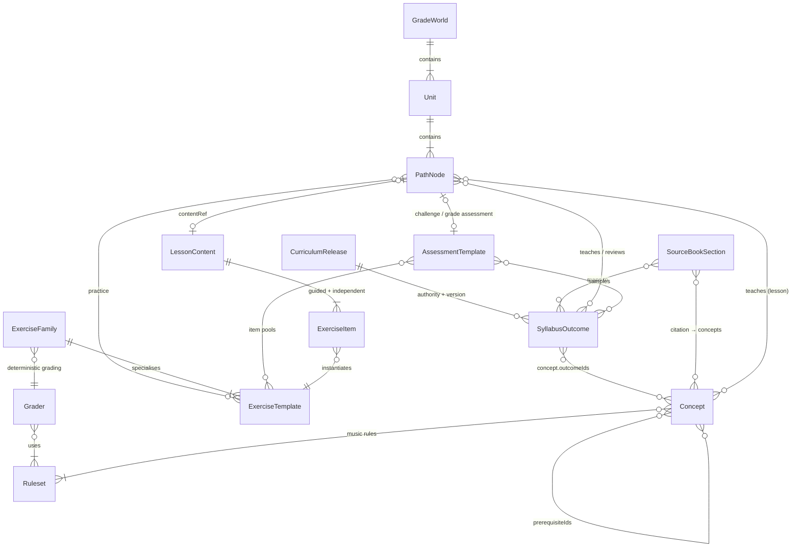

# Curriculum architecture (Brief 01)

This phase builds the **content foundation** that every later brief consumes. It defines the data model, the five-grade learning graph, reusable lesson and exercise contracts, and a validator that turns curriculum rules into failing builds. It deliberately contains **no UI, accounts or exercise engine**; those belong to Briefs 02–04.

## 1. Repository layout

```
content/                         ← source of truth (JSON, schema-validated)
  release.json                   CurriculumRelease: version, syllabus authority + hash, review status
  syllabus/abrsm-2020-outcomes.json   80 atomic official outcomes (SyllabusOutcome)
  syllabus/grade-scope.json      per-grade musical scope (keys, metres, clefs, intervals, chords …)
  syllabus/scope-concepts.json   which concept introduces each musical value (drives lesson-level narrowing)
  source-book/first-steps-sections.json   75 SourceBookSection citation records
  concepts/grade-N.json          Concepts with prerequisites and rule-set ids
  path/grade-N.json              GradeWorld: units + path nodes (lessons, practice, review, challenges, assessment)
  exercises/families.json        ExerciseFamily: interaction + grader + mistake feedback + accessibility
  exercises/templates/grade-N.json    ExerciseTemplate: grade-scoped, versioned
  exercises/items/*.json         standalone authored ExerciseItems (examples)
  assessments/grade-N.json       AssessmentTemplate blueprints (unit challenges, grade assessments)
  engine/engine.json             registries of rule sets and deterministic graders (contracts for Brief 03)
  policy/progression.json        provisional XP / mastery / review / unlock policy (for Brief 04)
  lessons/*.json                 LessonContent (two worked examples so far)
packages/curriculum/             TypeScript package @mtp/curriculum
  src/schema.ts                  zod schemas = the content contract
  src/load.ts, model.ts          loader + indexed graph (ancestors, scope, coverage inputs)
  src/validate.ts                curriculum rules → errors/warnings
  src/verify-music.ts            re-derives answers from notation using music rules
  src/music/                     pure reference music rules (pitch, interval, keys, chords, clefs, durations)
  src/coverage.ts, docs.ts, bundle.ts, cli.ts
docs/                            architecture, curriculum matrices (partly generated), handoff
```

**Stack decision.** The repository was empty. This phase adds only the smallest tooling that can be validated: an npm workspace with one TypeScript package (Node ≥ 20, zod 4, vitest, tsx). Brief 02 picks the app stack and adds packages beside this one (e.g. `packages/web`, `packages/api`). It imports `@mtp/curriculum` for types, loading and validation.

**Why JSON content rather than TS modules?** Teachers and content authors can review JSON diffs without reading code. A web app, a backend or a CMS can all read it. zod gives precise errors. `npm run bundle` produces a single `dist/curriculum.json` for consumers that want one file.

## 2. Content model



| Entity (Brief 01 name) | Where | Key fields |
|---|---|---|
| `CurriculumRelease` | `release.json` | semver, status (`draft → teacher_review → approved → superseded`), syllabus URL, document date, retrieval date, **SHA-256**, currency check, teacher review, changelog |
| `SyllabusOutcome` | `syllabus/…` | stable id `abrsm2020.gN.NN`, grade, source item number, domain, paraphrased statement, evidence status, `decomposition: author-interpretation`, teacher review |
| `SourceBookSection` | `source-book/…` | grade, section, heading (citation), **printed page**, scan page, classification, taught-at grade, units, concepts, outcomes, parts, reconciliation, `citation: pointer-only` |
| `Concept` | `concepts/…` | stable id `c.<domain>.<slug>`, grade, prerequisites, rule-set ids, status `core / supporting / enrichment`, outcomes |
| `Unit`, `PathNode` (`Lesson`) | `path/…` | sequence, type, objective, concepts, outcomes, review outcomes, **exercise bindings**, assessment, unlockAfter, optional, minutes, **contentVersion**, contentStatus, contentRef, book pointers |
| `ExerciseBinding` | on each node | `templateId`, the template `conceptIds` exercised here (all already taught), and `scope` narrowing every dimension the template declares to taught values |
| Mappings | embedded | Lesson↔Concept (`conceptIds`), Lesson↔Outcome (`outcomeIds`), BookSection↔Concept, BookSection↔Outcome, Assessment↔Outcome (`sections[].outcomeIds`) |
| `ExerciseTemplate` | `exercises/templates/…` | version, family (→ grader + feedback + accessibility), grade, mode, outcomes, concepts, original prompt pattern, **musical scope**, acceptance policy (spelling/octave/enharmonic/multiple answers), ambiguity checks, hints, difficulty, QA status and review requirements |
| `LessonContent` | `lessons/…` | objective + success criteria, micro-explanation, demonstration (notation + optional audio + text alternative), guided items, independent items, recap, spaced review, mastery rule, provenance |

**Reference provenance is separate from learner content.** Book sections and syllabus items live in `bookSectionIds` / `provenance` fields only. The validator rejects learner-facing text that names the book, its author or the exam board (risk of implied endorsement). It also rejects any committed PDF/EPUB file.

## 3. Identifiers and versioning

- IDs are human-readable, grade-prefixed and **never reused**. The validator checks every pattern, uniqueness across all entity types, and that each grade prefix matches the declared grade.
- Content entities carry their own version (`ExerciseTemplate.version`, `PathNode.contentVersion`, `AssessmentTemplate.version`). Learner attempts (Brief 04) must store the versions they answered, so a later change never rewrites history.
- **The path node's `contentVersion` identifies delivered lesson content.** A linked `LessonContent.contentVersion` must equal it (validated). Bump both together.
- Logical content paths (`contentRef`, file names in reports) always use `/`. Text files are LF (`.gitattributes`), and the generated-doc check ignores CRLF, so Windows checkouts verify identically.
- The curriculum as a whole is versioned by `release.version`. A syllabus change means a new `authorityId` and outcome set (e.g. `abrsm2027.*`), plus a new coverage audit. Old outcomes are retired, never edited in place.

## 4. Learning graph

- **Five grade worlds → units (5–7 per grade, 27 in total) → nodes.** Node types: `lesson`, `practice` (mixed unit practice), `review` (spaced, cumulative), `unit_challenge`, `grade_assessment`, `enrichment` (optional).
- **Unlocking** is derived: by default a node unlocks after the previous *required* lesson, practice or review node, and an explicit `unlockAfter` overrides that. Challenges and assessments are evidence, not gates. Enrichment hangs off a lesson and nothing required may depend on it.
- **Prerequisites are concept-level.** The validator computes each node's guaranteed-complete ancestors and fails if any prerequisite of a taught concept is not taught by an ancestor (or by the same lesson).
- **Revisiting.** Each unit has a review node: unit 1 of each grade reviews the previous grade; later units review earlier units; the last unit reviews the whole grade. Review nodes may only revisit outcomes already taught. Spaced review per concept is scheduled by Brief 04 using `policy/progression.json`.

## 5. Exercise architecture (one engine for all grades)

`ExerciseFamily` (grade-agnostic: interaction + deterministic grader + mistake categories + accessibility) → `ExerciseTemplate` (grade-specific scope and prompt pattern) → `ExerciseItem` (an authored or seeded instance).

- 22 families cover notation reading and writing, keyboard, rhythm building and grouping, tuplets, accidental state, scales, key signatures, degrees, intervals, triads and chords, cadences, transposition, chromatic scales, enharmonics, ornaments, vocabulary choice and composite score questions.
- **Graders** (`engine.json`) are contracts that Brief 03 implements. Each is deterministic, states its answer kind and whether it accepts multiple valid answers, and names the rule sets it relies on. No LLM is ever the source of truth for marking.
- **Grade scope** (`grade-scope.json`) is cumulative. Every template's `scope` must fit inside its grade, so a Grade 2 template cannot use B major or melodic minor, and cadence keys cannot go beyond C/G/D/F major.
- **Lesson-level narrowing.** A template is reusable across a grade, but each path node binds it with an `ExerciseBinding`. `scope-concepts.json` names the concept that introduces every musical value (bass clef → `c.clefs.bass`, quavers → `c.rhythm.values-short`, double accidentals → `c.accidentals.double`, E major → `c.scales.major-e-ab`, …). `taughtScope(node)` is the grade scope minus every value whose concept is not yet taught at that node. The validator requires each binding's concepts to be taught, its scope to lie within both the template and `taughtScope`, and every authored item's actual notes, clefs, keys, accidentals, rests, ties, tuplets, chords and answers to lie within `effectiveScope(node, binding)`. Generators (Brief 03) must sample from that same effective scope.
- **Multiple valid answers** are declared per template (`acceptance.multipleValidAnswers`), and the grader must support them (validated). Example: the cadence grader enumerates every chord pair that contains the melody notes and forms a permitted cadence, instead of relying on a hand-typed answer list.
- **Spelling-sensitive** by default: pitch is `{step, alter, octave}`. Enharmonic answers are rejected unless the template says sound, not spelling, is being assessed.

### Notation and answer contracts

- **Presentation.** A fragment is shown as `stave` notation (clef reading is assessed), a `rhythm-line` (unpitched: clef and the single display pitch are conventions only, so no clef, key or pitch knowledge is assumed) or a `keyboard` (no stave: clef and ledger lines don't apply, and black keys need `c.accidentals.signs`). This lets the first rhythm and keyboard lessons validate before any clef is taught, while stave tasks keep their clef prerequisite. Rhythm answers are always checked as rhythm lines.
- **Notation** (`NotationFragment`, `NotationScore`) is renderer-independent: notes, **chords** (simultaneous pitches, one duration), rests (including **whole-bar rests** that last exactly one bar), **tuplet groups** (`actual`:`normal`, e.g. 3:2, 2:3, 5:4) and **voices** within a bar. Events carry **beam flags** (the grouping a learner sees or edits), ties, slurs, articulations, ornament signs, grace notes, dynamics and labels. Multi-stave scores support SATB and short passages, including transposing parts.
- **Answers** (`AnswerSpec`) have one typed variant per family answer kind: `choice`, `multi-choice`, `pitch`, `staff-position` (with a target the validator re-derives), `pitch-sequence` (derivation `transpose` | `scale` | `chromatic`), `rhythm` (complete-bar, regroup, place-barlines, equivalent-value, add-tuplet), `time-signature`, `key-signature`, `interval` (identify/build, simple/compound; in minor keys only the minor forms allowed by the effective scope count, or the single form named by `minorForm`), `chord` (identify/build with inversion), `ornament-sign`, `chord-progression` and `composite` (sub-questions about one score). `test/fixtures/family-items.json` instantiates every registered family.
- **Every accepted alternative is verified** against the derived answer under the item's spelling, octave and enharmonic policy, not just the first one.

## 6. Validation pipeline

`npm run check` = typecheck + `validate` + `docs:check` + tests. Main rule groups (codes in `validate.ts`):

| Group | Fails when… |
|---|---|
| Coverage | any official outcome lacks a lesson, practice (template on a lesson/practice node), review node, assessment, or its own grade assessment |
| Source book | the count isn't 75 (19/14/12/15/15), sections are misnumbered, printed pages go backwards, a core section is unmapped or untaught, or a classification/grade is inconsistent |
| Prerequisites & path | untaught prerequisite, cycle, later-grade prerequisite, forward unlock, required→optional dependency, review of untaught outcome, malformed unit/grade structure |
| Exercises | no registered deterministic grader, no feedback, scope beyond grade, later-grade outcome/concept, multiple answers declared but unsupported |
| Assessments | outcome/template above the grade, enrichment-only template, unit challenge missing a unit outcome, grade assessment missing a grade outcome, challenge testing something not yet taught, unsatisfiable or malformed section `mix` balance rules (`ASSESSMENT_MIX`) |
| Bindings | binding concept not yet taught, binding scope wider than the template or the taught scope, template dimension not narrowed explicitly |
| Music verification | **any** accepted alternative differs from the derived answer (note reading, staff positions, scales, chromatic scales, transposition, intervals, chords and inversions, ornaments, cadence chords/types, composite parts), missing/incorrect accidentals (including ties across bar-lines), malformed ties/beams, bars or voices that don't add up (tuplets, chords, whole-bar rests), content outside the node's effective scope |
| IDs | duplicates, bad patterns, grade-prefix mismatch |
| Provenance & claims | committed PDFs, learner text citing the book or exam board, approved release without teacher sign-off, lesson/node version mismatch |
| `--release` gate | additionally requires teacher sign-off, approved outcomes and templates, approved content for every node, and a confirmed syllabus currency check (fails today, by design) |

## 7. What later briefs consume

| Brief | Consumes |
|---|---|
| 02 App shell | `GradeWorld`/`Unit`/`PathNode` for the map, lock reasons from resolved `unlockAfter`, `learnerTitle`s, `bundle` output |
| 03 Engine | `engine.json` grader and rule-set contracts, `families.json`, `ExerciseTemplate.scope`/`acceptance`, `effectiveScope(node, binding)` for generation, `NotationFragment`/`NotationScore`, `AnswerSpec`, the per-family fixtures and the reference rules in `src/music` (adopt, extend or replace behind the same contracts) |
| 04 Progression | `policy/progression.json`, node types, `evidence` flags on items, `spacedReview`, mastery rules |
| 05–09 Grades | lesson shells (objective, concepts, outcomes, templates, book pointers), `LessonContent` format and the two examples |
| 10 Assessment | `AssessmentTemplate` blueprints (seeded balanced sampling, hint-free, practice-only disclaimer) and the coverage matrix |
| 11 QA | `validate --release`, coverage and crosswalk docs, open questions |
