<!-- GENERATED FILE — do not edit by hand. Source: content/path/*.json, content/concepts/*.json. Regenerate with `npm run docs:generate`. -->

# Learning path and prerequisite graph

Five grade worlds · 27 units · 131 lessons · 5 optional enrichment nodes · 27 practice, 27 review, 27 unit-challenge and 5 grade-assessment nodes · 139 concepts.

**Unlock rule:** a node unlocks when the nodes in *Unlocks after* are complete. When no list is authored, it unlocks after the previous required lesson, practice or review node. Unit challenges and grade assessments collect independent mastery evidence and never block the next lesson. Enrichment is optional, and no required node depends on it. The validator checks that every concept prerequisite is taught by a node that is guaranteed to be complete first.

```mermaid
flowchart LR
  subgraph G1["Grade 1: First Notes"]
    G1_U1["G1-U1 Long and short sounds"] --> G1_U2["G1-U2 Count the beat"] --> G1_U3["G1-U3 The keyboard and the stave"] --> G1_U4["G1-U4 Sharps, flats and naturals"] --> G1_U5["G1-U5 Major scales and keys"] --> G1_U6["G1-U6 Triads and intervals"] --> G1_U7["G1-U7 Read the music"] --> G1_A(["Grade 1 assessment"])
  end
  subgraph G2["Grade 2: New Times and Keys"]
    G2_U1["G2-U1 New beats and triplets"] --> G2_U2["G2-U2 Neat rhythms and high and low notes"] --> G2_U3["G2-U3 New major keys"] --> G2_U4["G2-U4 Minor keys"] --> G2_U5["G2-U5 Intervals and expression"] --> G2_A(["Grade 2 assessment"])
  end
  subgraph G3["Grade 3: Compound Time and Minor Keys"]
    G3_U1["G3-U1 Beats in threes"] --> G3_U2["G3-U2 Very short notes"] --> G3_U3["G3-U3 Higher, lower, an octave away"] --> G3_U4["G3-U4 More keys, two minor forms"] --> G3_U5["G3-U5 Naming intervals exactly"] --> G3_A(["Grade 3 assessment"])
  end
  subgraph G4["Grade 4: Clefs, Chords and Colour"]
    G4_U1["G4-U1 Every regular time"] --> G4_U2["G4-U2 Spelling and the alto clef"] --> G4_U3["G4-U3 More keys and every semitone"] --> G4_U4["G4-U4 Intervals and the three main chords"] --> G4_U5["G4-U5 Ornaments and the orchestra"] --> G4_A(["Grade 4 assessment"])
  end
  subgraph G5["Grade 5: Harmony and the Score"]
    G5_U1["G5-U1 Fives and sevens"] --> G5_U2["G5-U2 Four clefs"] --> G5_U3["G5-U3 Keys, intervals and transposing"] --> G5_U4["G5-U4 Harmony"] --> G5_U5["G5-U5 The score in context"] --> G5_A(["Grade 5 assessment"])
  end
  G1_U7 --> G2_U1
  G2_U5 --> G3_U1
  G3_U5 --> G4_U1
  G4_U5 --> G5_U1
```

## Grade 1 — First Notes

Rhythm, the stave, treble and bass clefs, the first four major keys, tonic triads, interval numbers and the language of performance.

### G1-U1 — Long and short sounds

*Note values, rests, ties and dots.* How long sounds and silences last, and how ties and dots lengthen notes. Book sections: G1 §1, G1 §3, G1 §11, G1 §12.

| Node | Type | Title | Objective | Concepts (prerequisites) | Outcomes | Unlocks after | Min |
|---|---|---|---|---|---|---|---:|
| `G1-U1-L01` | Lesson | Beats, crotchets, minims and semibreves | Feel a steady beat and compare crotchets, minims and semibreves by how many beats they last. | `c.rhythm.beat` `c.rhythm.values-long` (`c.rhythm.beat`) | g1.01 | start | 5 |
| `G1-U1-L02` | Lesson | Quavers and semiquavers | Recognise quavers and semiquavers and say how many fit into a crotchet. | `c.rhythm.values-short` (`c.rhythm.values-long`) | g1.01 | `G1-U1-L01` | 5 |
| `G1-U1-L03` | Lesson | Flags and beams | Recognise the same quavers and semiquavers written with flags or joined by beams. | `c.rhythm.beams` (`c.rhythm.values-short`) | g1.01 | `G1-U1-L02` | 4 |
| `G1-U1-L04` | Lesson | Rests | Match each Grade 1 note value with its rest and read the semibreve and minim rests correctly. | `c.rhythm.rests` (`c.rhythm.values-short`) | g1.02 | `G1-U1-L03` | 5 |
| `G1-U1-L05` | Lesson | Ties | Add the values of tied notes to find how long the sound lasts. | `c.rhythm.ties` (`c.rhythm.values-long`) | g1.03 | `G1-U1-L04` | 5 |
| `G1-U1-L06` | Lesson | Dotted notes | Work out the length of a dotted note and choose between a tie and a dot. | `c.rhythm.dots` (`c.rhythm.ties`, `c.rhythm.values-short`) | g1.04 | `G1-U1-L05` | 6 |
| `G1-U1-P1` | Practice | Practice: Long and short sounds | Mixed independent practice of everything in this unit. | — | g1.01, g1.02, g1.03, g1.04 | `G1-U1-L06` | 6 |
| `G1-U1-R1` | Review | Review: long and short sounds | Revisit earlier material so it stays fresh. | — | g1.01, g1.02, g1.03, g1.04 | `G1-U1-P1` | 6 |
| `G1-U1-C` | Unit challenge | Unit challenge: Long and short sounds | Show independently, without hints, what you can do from this unit. | — | see `a.g1-u1` | `G1-U1-R1` | 8 |

### G1-U2 — Count the beat

*Bars and simple time.* Bars, bar-lines, 2/4 3/4 4/4, completing bars and grouping notes clearly. Book sections: G1 §2, G1 §11, G1 §18.

Refinements to the provisional unit map: Rest placement within bars is introduced here at a basic level because the outline lists rests at Grade 1; full rest-grouping rules remain in Grade 2 (see OPEN_QUESTIONS Q3).

| Node | Type | Title | Objective | Concepts (prerequisites) | Outcomes | Unlocks after | Min |
|---|---|---|---|---|---|---|---:|
| `G1-U2-L01` | Lesson | Bars and bar-lines | Explain how bar-lines group beats and why the first beat of a bar is stronger. | `c.metre.bars` (`c.rhythm.values-long`) | g1.06 | `G1-U1-R1` | 5 |
| `G1-U2-L02` | Lesson | Time signatures 2/4, 3/4 and 4/4 | Read the top and bottom numbers of 2/4, 3/4 and 4/4 (and the C sign). | `c.metre.simple-crotchet` (`c.metre.bars`) | g1.05 | `G1-U2-L01` | 5 |
| `G1-U2-L03` | Lesson | Complete the bar | Complete bars in 2/4, 3/4 and 4/4 using notes, dotted notes and rests. | `c.metre.bar-completion` (`c.metre.simple-crotchet`, `c.rhythm.dots`, `c.rhythm.rests`) | g1.05, g1.06 | `G1-U2-L02` | 6 |
| `G1-U2-L04` | Lesson | Grouping notes to show the beat | Beam quavers and semiquavers so that every beat is easy to see, including the 4/4 half-bar convention. | `c.metre.grouping-g1` (`c.metre.bar-completion`, `c.rhythm.beams`) | g1.07 | `G1-U2-L03` | 7 |
| `G1-U2-L05` | Lesson | Ties or single notes? | Replace unnecessary ties with single or dotted notes, and keep ties that show the beat. | `c.metre.ties-in-bars` (`c.metre.grouping-g1`, `c.rhythm.ties`) | g1.07 | `G1-U2-L04` | 6 |
| `G1-U2-L06` | Lesson | Rests in a bar | Use a semibreve rest for a silent bar and place simple rests on the beat in 2/4, 3/4 and 4/4. | `c.metre.rests-in-bars-g1` (`c.metre.bar-completion`) | g1.02, g1.07 | `G1-U2-L05` | 5 |
| `G1-U2-P1` | Practice | Practice: Count the beat | Mixed independent practice of everything in this unit. | — | g1.06, g1.05, g1.07, g1.02 | `G1-U2-L06` | 6 |
| `G1-U2-R1` | Review | Review: earlier units | Spaced review of earlier units in this grade, mixed with the new unit. | — | g1.01, g1.02, g1.03, g1.04 | `G1-U2-P1` | 6 |
| `G1-U2-C` | Unit challenge | Unit challenge: Count the beat | Show independently, without hints, what you can do from this unit. | — | see `a.g1-u2` | `G1-U2-R1` | 8 |

### G1-U3 — The keyboard and the stave

*Keyboard, stave, clefs and ledger lines.* Letter names, the keyboard, the stave, treble and bass clefs, middle C and writing notes. Book sections: G1 §4, G1 §5, G1 §6, G1 §7.

| Node | Type | Title | Objective | Concepts (prerequisites) | Outcomes | Unlocks after | Min |
|---|---|---|---|---|---|---|---:|
| `G1-U3-L01` | Lesson | Letter names on the keyboard | Name white keys from A to G using the groups of black keys. | `c.pitch.letter-names` `c.pitch.keyboard` (`c.pitch.letter-names`) | g1.09 | `G1-U2-R1` | 5 |
| `G1-U3-L02` | Lesson | The stave: lines and spaces | Count the lines and spaces of a stave from the bottom and say whether a note is on a line or in a space. | `c.clefs.stave` (`c.pitch.letter-names`) | g1.08 | `G1-U3-L01` | 4 |
| `G1-U3-L03` | Lesson | Treble clef: notes on the lines | Read and place the five treble-clef line notes (E, G, B, D, F). | `c.clefs.treble-lines` (`c.clefs.stave`) | g1.08, g1.09 | `G1-U3-L02` | 6 |
| `G1-U3-L04` | Lesson | Treble clef: notes in the spaces | Read and place the four treble-clef space notes (F, A, C, E). | `c.clefs.treble-spaces` (`c.clefs.treble-lines`) | g1.09 | `G1-U3-L03` | 6 |
| `G1-U3-L05` | Lesson | The bass clef | Read and place bass-clef line and space notes, using F on the fourth line as a guide. | `c.clefs.bass` (`c.clefs.stave`) | g1.08, g1.09 | `G1-U3-L04` | 7 |
| `G1-U3-L06` | Lesson | Middle C and ledger lines | Read and write middle C on a ledger line in both clefs and find it on the keyboard. | `c.pitch.middle-c` (`c.clefs.treble-lines`, `c.clefs.bass`, `c.pitch.keyboard`) | g1.09 | `G1-U3-L05` | 6 |
| `G1-U3-L07` | Lesson | Writing notes neatly | Write note-heads, stems and flags on the stave with stems on the correct side. | `c.pitch.note-writing` (`c.clefs.treble-spaces`, `c.clefs.bass`, `c.rhythm.values-short`) | g1.09 | `G1-U3-L06` | 6 |
| `G1-U3-P1` | Practice | Practice: The keyboard and the stave | Mixed independent practice of everything in this unit. | — | g1.09, g1.08 | `G1-U3-L07` | 6 |
| `G1-U3-R1` | Review | Review: earlier units | Spaced review of earlier units in this grade, mixed with the new unit. | — | g1.01, g1.02, g1.03, g1.04, g1.06, g1.05, g1.07 | `G1-U3-P1` | 6 |
| `G1-U3-C` | Unit challenge | Unit challenge: The keyboard and the stave | Show independently, without hints, what you can do from this unit. | — | see `a.g1-u3` | `G1-U3-R1` | 8 |

### G1-U4 — Sharps, flats and naturals

*Sharps, flats and naturals.* Accidentals on the keyboard and stave, how long they last and how they are cancelled. Book sections: G1 §8, G1 §14.

| Node | Type | Title | Objective | Concepts (prerequisites) | Outcomes | Unlocks after | Min |
|---|---|---|---|---|---|---|---:|
| `G1-U4-L01` | Lesson | Sharps, flats and naturals on the keyboard | Name black keys as sharps or flats and explain what a natural sign does. | `c.accidentals.signs` (`c.pitch.keyboard`) | g1.10 | `G1-U3-R1` | 5 |
| `G1-U4-L02` | Lesson | Accidentals on the stave | Write an accidental before a note on the same line or space and read notes with accidentals. | `c.accidentals.on-stave` (`c.accidentals.signs`, `c.clefs.treble-spaces`, `c.clefs.bass`) | g1.10 | `G1-U4-L01` | 5 |
| `G1-U4-L03` | Lesson | How long does an accidental last? | Decide which notes in a bar an accidental affects, including tied notes over a bar-line. | `c.accidentals.bar-rule` (`c.accidentals.on-stave`, `c.metre.bars`, `c.rhythm.ties`) | g1.10 | `G1-U4-L02` | 7 |
| `G1-U4-L04` | Lesson | Cancelling accidentals | Use a natural sign to cancel a sharp or flat and spot unnecessary accidentals. | `c.accidentals.cancellation` (`c.accidentals.bar-rule`) | g1.10 | `G1-U4-L03` | 6 |
| `G1-U4-P1` | Practice | Practice: Sharps, flats and naturals | Mixed independent practice of everything in this unit. | — | g1.10 | `G1-U4-L04` | 6 |
| `G1-U4-R1` | Review | Review: earlier units | Spaced review of earlier units in this grade, mixed with the new unit. | — | g1.01, g1.02, g1.03, g1.04, g1.06, g1.05, g1.07, g1.09, g1.08 | `G1-U4-P1` | 6 |
| `G1-U4-C` | Unit challenge | Unit challenge: Sharps, flats and naturals | Show independently, without hints, what you can do from this unit. | — | see `a.g1-u4` | `G1-U4-R1` | 8 |

### G1-U5 — Major scales and keys

*Tones, semitones and major keys.* Semitones and tones; C, G, D and F major scales; key signatures; degrees by number. Book sections: G1 §9, G1 §10, G1 §13, G1 §15.

| Node | Type | Title | Objective | Concepts (prerequisites) | Outcomes | Unlocks after | Min |
|---|---|---|---|---|---|---|---:|
| `G1-U5-L01` | Lesson | Semitones and tones | Find semitones and tones on the keyboard. | `c.pitch.tones-semitones` (`c.accidentals.signs`) | g1.11 | `G1-U4-R1` | 5 |
| `G1-U5-L02` | Lesson | Building C major | Build the C major scale and mark where its semitones fall. | `c.scales.major-pattern` (`c.pitch.tones-semitones`, `c.clefs.treble-spaces`, `c.clefs.bass`) | g1.11, g1.12 | `G1-U5-L01` | 6 |
| `G1-U5-L03` | Lesson | G and D major: raising notes | Build G and D major by raising notes to keep the major pattern. | `c.scales.major-sharp-g1` (`c.scales.major-pattern`, `c.accidentals.on-stave`) | g1.11, g1.12 | `G1-U5-L02` | 7 |
| `G1-U5-L04` | Lesson | F major: lowering a note | Build F major by lowering the fourth note. | `c.scales.major-f` (`c.scales.major-pattern`, `c.accidentals.on-stave`) | g1.11, g1.12 | `G1-U5-L03` | 6 |
| `G1-U5-L05` | Lesson | Keys and key signatures | Recognise and write the key signatures of C, G, D and F major in both clefs. | `c.keys.signature-concept` (`c.scales.major-sharp-g1`, `c.scales.major-f`, `c.accidentals.bar-rule`) `c.keys.signatures-g1` (`c.keys.signature-concept`) | g1.13 | `G1-U5-L04` | 7 |
| `G1-U5-L06` | Lesson | Writing scales with and without key signatures | Write C, G, D and F major ascending and descending in both clefs, with and without key signatures. | `c.scales.writing-g1` (`c.keys.signatures-g1`) | g1.12, g1.13 | `G1-U5-L05` | 7 |
| `G1-U5-L07` | Lesson | Scale degrees by number | Number the degrees of a scale and name the degree of a note in a Grade 1 key. | `c.scales.degree-numbers` (`c.scales.major-pattern`) | g1.15 | `G1-U5-L06` | 5 |
| `G1-U5-P1` | Practice | Practice: Major scales and keys | Mixed independent practice of everything in this unit. | — | g1.11, g1.12, g1.13, g1.15 | `G1-U5-L07` | 6 |
| `G1-U5-R1` | Review | Review: earlier units | Spaced review of earlier units in this grade, mixed with the new unit. | — | g1.01, g1.02, g1.03, g1.04, g1.06, g1.05, g1.07, g1.09, g1.08, g1.10 | `G1-U5-P1` | 6 |
| `G1-U5-C` | Unit challenge | Unit challenge: Major scales and keys | Show independently, without hints, what you can do from this unit. | — | see `a.g1-u5` | `G1-U5-R1` | 8 |

### G1-U6 — Triads and intervals

*Tonic triads and intervals.* Tonic triads in root position and interval numbers above the tonic. Book sections: G1 §16, G1 §17.

| Node | Type | Title | Objective | Concepts (prerequisites) | Outcomes | Unlocks after | Min |
|---|---|---|---|---|---|---|---:|
| `G1-U6-L01` | Lesson | The tonic triad | Build and recognise tonic triads in C, G, D and F major in both clefs. | `c.chords.tonic-triad` (`c.scales.degree-numbers`, `c.keys.signatures-g1`) | g1.14 | `G1-U5-R1` | 6 |
| `G1-U6-L02` | Lesson | Interval numbers | Count letter names to give the number of an interval. | `c.intervals.number` (`c.pitch.letter-names`, `c.scales.degree-numbers`) | g1.16 | `G1-U6-L01` | 5 |
| `G1-U6-L03` | Lesson | Intervals above the tonic | Identify and write intervals above the tonic in C, G, D and F major, harmonic and melodic. | `c.intervals.above-tonic-number` (`c.intervals.number`, `c.keys.signatures-g1`) | g1.16 | `G1-U6-L02` | 6 |
| `G1-U6-P1` | Practice | Practice: Triads and intervals | Mixed independent practice of everything in this unit. | — | g1.14, g1.16 | `G1-U6-L03` | 6 |
| `G1-U6-R1` | Review | Review: earlier units | Spaced review of earlier units in this grade, mixed with the new unit. | — | g1.01, g1.02, g1.03, g1.04, g1.06, g1.05, g1.07, g1.09, g1.08, g1.10, g1.11, g1.12, g1.13, g1.15 | `G1-U6-P1` | 6 |
| `G1-U6-C` | Unit challenge | Unit challenge: Triads and intervals | Show independently, without hints, what you can do from this unit. | — | see `a.g1-u6` | `G1-U6-R1` | 8 |

### G1-U7 — Read the music

*Terms, signs and melody reading.* Tempo, dynamics, performance directions and articulation, applied to short original melodies. Book sections: G1 §19.

Refinements to the provisional unit map: Music-in-context lesson added: the official outline asks questions about a melody, which the source book does not cover.

| Node | Type | Title | Objective | Concepts (prerequisites) | Outcomes | Unlocks after | Min |
|---|---|---|---|---|---|---|---:|
| `G1-U7-L01` | Lesson | How fast? Tempo terms | Understand common tempo terms and metronome marks. | `c.terms.tempo-g1` | g1.17 | `G1-U6-R1` | 5 |
| `G1-U7-L02` | Lesson | How loud? Dynamics | Understand dynamic marks and hairpins. | `c.terms.dynamics-g1` | g1.18 | `G1-U7-L01` | 5 |
| `G1-U7-L03` | Lesson | Directions and signs | Follow repeat marks, pause, 8va and other performance directions. | `c.terms.directions-g1` (`c.rhythm.ties`) | g1.19 | `G1-U7-L02` | 6 |
| `G1-U7-L04` | Lesson | Articulation | Recognise staccato, accent and legato markings. | `c.terms.articulation-g1` | g1.20 | `G1-U7-L03` | 5 |
| `G1-U7-L05` | Lesson | Looking closely at a melody | Answer questions about an original melody using everything from Grade 1. | `c.context.melody-g1` (`c.terms.tempo-g1`, `c.terms.dynamics-g1`, `c.terms.directions-g1`, `c.terms.articulation-g1`, `c.intervals.above-tonic-number`, `c.metre.grouping-g1`, `c.keys.signatures-g1`) | g1.21 | `G1-U7-L04` | 8 |
| `G1-U7-P1` | Practice | Practice: Read the music | Mixed independent practice of everything in this unit. | — | g1.17, g1.18, g1.19, g1.20, g1.21 | `G1-U7-L05` | 6 |
| `G1-U7-R1` | Review | Grade review | Cumulative spaced review of the whole grade before the unit challenge and grade assessment. | — | g1.01, g1.02, g1.03, g1.04, g1.06, g1.05, g1.07, g1.09, g1.08, g1.10, g1.11, g1.12, g1.13, g1.15, g1.14, g1.16, g1.17, g1.18, g1.19, g1.20, g1.21 | `G1-U7-P1` | 6 |
| `G1-U7-C` | Unit challenge | Unit challenge: Read the music | Show independently, without hints, what you can do from this unit. | — | see `a.g1-u7` | `G1-U7-R1` | 8 |

**Grade 1 assessment** (`G1-A`, assessment `a.g1`) — An independent, hint-free assessment that samples every Grade 1 outcome and earlier essentials.

## Grade 2 — New Times and Keys

Minim and quaver beats, triplets, rest grouping, two ledger lines, A/B♭/E♭ major and A/E/D harmonic minor.

### G2-U1 — New beats and triplets

*New simple time signatures and triplets.* 2/2, 3/2, 4/2, 3/8; duple, triple, quadruple; triplets. Book sections: G2 §1, G2 §2.

| Node | Type | Title | Objective | Concepts (prerequisites) | Outcomes | Unlocks after | Min |
|---|---|---|---|---|---|---|---:|
| `G2-U1-L01` | Lesson | Minim beats: 2/2, 3/2 and 4/2 | Read time signatures with minim beats and count them. | `c.metre.minim-beats` (`c.metre.simple-crotchet`) | g2.01 | `G1-U7-R1` | 6 |
| `G2-U1-L02` | Lesson | Quaver beats: 3/8 | Read 3/8 and compare it with 3/4. | `c.metre.quaver-beats` (`c.metre.simple-crotchet`) | g2.01 | `G2-U1-L01` | 5 |
| `G2-U1-L03` | Lesson | Duple, triple and quadruple | Describe any Grade 1–2 time signature as duple, triple or quadruple, and explain why 2/2 and 4/4 can look alike. | `c.metre.beat-classification` (`c.metre.minim-beats`, `c.metre.quaver-beats`) | g2.01 | `G2-U1-L02` | 5 |
| `G2-U1-L04` | Lesson | Triplets | Read and write triplets: three notes in the time of two. | `c.rhythm.triplets` (`c.rhythm.values-short`, `c.rhythm.beams`) | g2.03 | `G2-U1-L03` | 6 |
| `G2-U1-L05` | Lesson | Triplets with rests and mixed values | Read triplet groups that contain rests or mixed values adding up to three equal notes. | `c.rhythm.triplets-mixed` (`c.rhythm.triplets`, `c.rhythm.rests`) | g2.04 | `G2-U1-L04` | 6 |
| `G2-U1-P1` | Practice | Practice: New beats and triplets | Mixed independent practice of everything in this unit. | — | g2.01, g2.03, g2.04 | `G2-U1-L05` | 6 |
| `G2-U1-R1` | Review | Review: Grade 1 foundations | Revisit earlier material so it stays fresh. | — | g1.01, g1.02, g1.03, g1.04, g1.05, g1.06, g1.07, g1.08, g1.09, g1.10, g1.11, g1.12, g1.13, g1.14, g1.15, g1.16, g1.17, g1.18, g1.19, g1.20, g1.21 | `G2-U1-P1` | 6 |
| `G2-U1-C` | Unit challenge | Unit challenge: New beats and triplets | Show independently, without hints, what you can do from this unit. | — | see `a.g2-u1` | `G2-U1-R1` | 8 |

### G2-U2 — Neat rhythms and high and low notes

*Grouping notes and rests; two ledger lines.* Note and rest grouping in all Grade 1–2 times; two ledger lines. Book sections: G2 §3, G2 §4, G2 §5.

| Node | Type | Title | Objective | Concepts (prerequisites) | Outcomes | Unlocks after | Min |
|---|---|---|---|---|---|---|---:|
| `G2-U2-L01` | Lesson | Grouping notes in the new times | Beam notes correctly in 2/2, 3/2, 4/2 and 3/8. | `c.metre.grouping-g2` (`c.metre.minim-beats`, `c.metre.quaver-beats`, `c.metre.grouping-g1`) | g2.02 | `G2-U1-R1` | 7 |
| `G2-U2-L02` | Lesson | A new rest for each silent beat | Write rests so that each silent beat starts with a new rest. | `c.metre.rest-grouping-beats` (`c.metre.rests-in-bars-g1`, `c.metre.grouping-g2`) | g2.02 | `G2-U2-L01` | 6 |
| `G2-U2-L03` | Lesson | Two-beat rests in four-beat bars | Use two-beat rests for the first or last half of a four-beat bar, but not the middle. | `c.metre.rest-grouping-half-bar` (`c.metre.rest-grouping-beats`) | g2.02 | `G2-U2-L02` | 6 |
| `G2-U2-L04` | Lesson | Rests for part of a beat | Write rests for half-beats and quarter-beats in the right order. | `c.metre.rest-grouping-subdivisions` (`c.metre.rest-grouping-half-bar`) | g2.02 | `G2-U2-L03` | 7 |
| `G2-U2-L05` | Lesson | Two ledger lines | Read and write notes with up to two ledger lines above or below each stave. | `c.pitch.ledger-two` (`c.pitch.middle-c`) | g2.05 | `G2-U2-L04` | 6 |
| `G2-U2-L06` | Lesson | The same note in two clefs | Recognise the same pitch written with ledger lines in one clef or on the stave in the other. | `c.clefs.same-pitch-treble-bass` (`c.pitch.ledger-two`) | g2.05 | `G2-U2-L05` | 5 |
| `G2-U2-P1` | Practice | Practice: Neat rhythms and high and low notes | Mixed independent practice of everything in this unit. | — | g2.02, g2.05 | `G2-U2-L06` | 6 |
| `G2-U2-R1` | Review | Review: earlier units | Spaced review of earlier units in this grade, mixed with the new unit. | — | g2.01, g2.03, g2.04 | `G2-U2-P1` | 6 |
| `G2-U2-C` | Unit challenge | Unit challenge: Neat rhythms and high and low notes | Show independently, without hints, what you can do from this unit. | — | see `a.g2-u2` | `G2-U2-R1` | 8 |

### G2-U3 — New major keys

*A, B flat and E flat major.* Three new major scales, key-signature order and their tonic triads and degrees. Book sections: G2 §6, G2 §7, G2 §8.

| Node | Type | Title | Objective | Concepts (prerequisites) | Outcomes | Unlocks after | Min |
|---|---|---|---|---|---|---|---:|
| `G2-U3-L01` | Lesson | A major | Build A major and explain why it needs three sharps. | `c.scales.major-a` (`c.scales.writing-g1`) | g2.08 | `G2-U2-R1` | 6 |
| `G2-U3-L02` | Lesson | B flat and E flat major | Build B♭ and E♭ major — scales that start on a black key. | `c.scales.major-bb-eb` (`c.scales.writing-g1`) | g2.08 | `G2-U3-L01` | 7 |
| `G2-U3-L03` | Lesson | Key signatures up to three sharps or flats | Write major key signatures in the correct order and positions in both clefs. | `c.keys.signatures-g2-major` (`c.scales.major-a`, `c.scales.major-bb-eb`, `c.keys.signatures-g1`) | g2.08 | `G2-U3-L02` | 6 |
| `G2-U3-L04` | Lesson | Tonic triads and degrees in the new major keys | Build tonic triads and name degrees by number in A, B♭ and E♭ major. | `c.chords.tonic-triad-g2-major` (`c.keys.signatures-g2-major`, `c.chords.tonic-triad`) | g2.10, g2.11 | `G2-U3-L03` | 6 |
| `G2-U3-P1` | Practice | Practice: New major keys | Mixed independent practice of everything in this unit. | — | g2.08, g2.10, g2.11 | `G2-U3-L04` | 6 |
| `G2-U3-R1` | Review | Review: earlier units | Spaced review of earlier units in this grade, mixed with the new unit. | — | g2.01, g2.03, g2.04, g2.02, g2.05 | `G2-U3-P1` | 6 |
| `G2-U3-C` | Unit challenge | Unit challenge: New major keys | Show independently, without hints, what you can do from this unit. | — | see `a.g2-u3` | `G2-U3-R1` | 8 |

### G2-U4 — Minor keys

*Relative keys and harmonic minor.* Minor scales (harmonic form), relative keys, A/E/D minor. Book sections: G2 §9, G2 §10, G2 §12.

Refinements to the provisional unit map: Book §11 (melodic minor) and the melodic half of §9 are deferred to G3-U4; an optional preview is offered here and is never assessed.

| Node | Type | Title | Objective | Concepts (prerequisites) | Outcomes | Unlocks after | Min |
|---|---|---|---|---|---|---|---:|
| `G2-U4-L01` | Lesson | What makes a scale minor? | Hear and see the difference between major and minor, focusing on the semitone between degrees 2 and 3. | `c.scales.minor-concept` (`c.scales.major-pattern`) | g2.07 | `G2-U3-R1` | 5 |
| `G2-U4-L02` | Lesson | Relative major and minor | Find the relative minor of C, G and F major and the relative major of A, E and D minor. | `c.keys.relative` (`c.scales.minor-concept`, `c.keys.signatures-g1`) | g2.06 | `G2-U4-L01` | 6 |
| `G2-U4-L03` | Lesson | Harmonic minor: raising the 7th | Build a harmonic minor scale by raising the 7th degree. | `c.scales.minor-harmonic` (`c.keys.relative`) | g2.07, g2.09 | `G2-U4-L02` | 7 |
| `G2-U4-L04` | Lesson | A, E and D harmonic minor | Write A, E and D harmonic minor in both clefs, with and without key signatures. | `c.scales.minor-harmonic-g2` (`c.scales.minor-harmonic`) | g2.09 | `G2-U4-L03` | 7 |
| `G2-U4-L05` | Lesson | Minor key signatures and tonic triads | Write minor key signatures and tonic triads, and name degrees in A, E and D minor. | `c.keys.minor-g2` (`c.scales.minor-harmonic-g2`, `c.chords.tonic-triad-g2-major`) | g2.09, g2.10, g2.11 | `G2-U4-L04` | 6 |
| `G2-U4-E1` | Enrichment (optional) | Coming later: the melodic minor | Optional preview of the melodic minor scale, which becomes required in Grade 3. | `c.scales.minor-melodic-preview` (`c.scales.minor-harmonic`) | — | `G2-U4-L03` | 4 |
| `G2-U4-P1` | Practice | Practice: Minor keys | Mixed independent practice of everything in this unit. | — | g2.07, g2.06, g2.09, g2.10, g2.11 | `G2-U4-L05` | 6 |
| `G2-U4-R1` | Review | Review: earlier units | Spaced review of earlier units in this grade, mixed with the new unit. | — | g2.01, g2.03, g2.04, g2.02, g2.05, g2.08, g2.10, g2.11 | `G2-U4-P1` | 6 |
| `G2-U4-C` | Unit challenge | Unit challenge: Minor keys | Show independently, without hints, what you can do from this unit. | — | see `a.g2-u4` | `G2-U4-R1` | 8 |

### G2-U5 — Intervals and expression

*Intervals, terms and melody reading.* Interval numbers above the tonic in major and minor keys; new terms and signs in context. Book sections: G2 §13, G2 §14.

| Node | Type | Title | Objective | Concepts (prerequisites) | Outcomes | Unlocks after | Min |
|---|---|---|---|---|---|---|---:|
| `G2-U5-L01` | Lesson | Intervals in the new keys | Give the number of intervals above the tonic in all Grade 2 major and minor keys. | `c.intervals.above-tonic-number-g2` (`c.intervals.above-tonic-number`, `c.keys.minor-g2`) | g2.12 | `G2-U4-R1` | 6 |
| `G2-U5-L02` | Lesson | More tempo and character words | Understand the Grade 2 tempo and character terms. | `c.terms.g2-words` (`c.terms.tempo-g1`) | g2.13 | `G2-U5-L01` | 6 |
| `G2-U5-L03` | Lesson | Accents and touch signs | Recognise accents, semi-staccato, staccatissimo and tenuto signs. | `c.terms.g2-signs` (`c.terms.articulation-g1`) | g2.13 | `G2-U5-L02` | 5 |
| `G2-U5-L04` | Lesson | Looking closely at a melody (Grade 2) | Answer questions about an original melody using Grades 1–2 knowledge. | `c.context.melody-g2` (`c.context.melody-g1`, `c.terms.g2-words`, `c.terms.g2-signs`, `c.intervals.above-tonic-number-g2`, `c.metre.grouping-g2`) | g1.21 | `G2-U5-L03` | 8 |
| `G2-U5-P1` | Practice | Practice: Intervals and expression | Mixed independent practice of everything in this unit. | — | g2.12, g2.13, g1.21 | `G2-U5-L04` | 6 |
| `G2-U5-R1` | Review | Grade review | Cumulative spaced review of the whole grade before the unit challenge and grade assessment. | — | g2.01, g2.03, g2.04, g2.02, g2.05, g2.08, g2.10, g2.11, g2.07, g2.06, g2.09, g2.12, g2.13, g1.21 | `G2-U5-P1` | 6 |
| `G2-U5-C` | Unit challenge | Unit challenge: Intervals and expression | Show independently, without hints, what you can do from this unit. | — | see `a.g2-u5` | `G2-U5-R1` | 8 |

**Grade 2 assessment** (`G2-A`, assessment `a.g2`) — An independent, hint-free assessment that samples every Grade 2 outcome and earlier essentials.

## Grade 3 — Compound Time and Minor Keys

Compound time, demisemiquavers, extended ledger lines, octave transposition, keys to four sharps/flats with both minor forms, interval qualities.

### G3-U1 — Beats in threes

*Simple and compound time.* Compound time signatures and grouping of notes and rests. Book sections: G3 §1, G3 §2, G3 §3.

| Node | Type | Title | Objective | Concepts (prerequisites) | Outcomes | Unlocks after | Min |
|---|---|---|---|---|---|---|---:|
| `G3-U1-L01` | Lesson | Simple or compound? | Tell simple time from compound time by how the beat divides. | `c.metre.compound-concept` (`c.metre.beat-classification`, `c.rhythm.dots`) | g3.01 | `G2-U5-R1` | 6 |
| `G3-U1-L02` | Lesson | 6/8, 9/8 and 12/8 | Read compound duple, triple and quadruple time signatures. | `c.metre.compound-signatures` (`c.metre.compound-concept`) | g3.01 | `G3-U1-L01` | 6 |
| `G3-U1-L03` | Lesson | Grouping notes in compound time | Beam notes in dotted-crotchet beats and use ties to show beats. | `c.metre.compound-grouping-notes` (`c.metre.compound-signatures`, `c.metre.grouping-g2`) | g3.02 | `G3-U1-L02` | 7 |
| `G3-U1-L04` | Lesson | Grouping rests in compound time | Write rests for silent beats and part-beats in compound time, accepting both forms of a silent beat. | `c.metre.compound-grouping-rests` (`c.metre.compound-grouping-notes`, `c.metre.rest-grouping-subdivisions`) | g3.02 | `G3-U1-L03` | 7 |
| `G3-U1-L05` | Lesson | Triplets or compound time? | Compare triplets in simple time with the same rhythm in compound time. | `c.metre.triplet-compound` (`c.metre.compound-signatures`, `c.rhythm.triplets`) | g3.01 | `G3-U1-L04` | 5 |
| `G3-U1-P1` | Practice | Practice: Beats in threes | Mixed independent practice of everything in this unit. | — | g3.01, g3.02 | `G3-U1-L05` | 6 |
| `G3-U1-R1` | Review | Review: Grade 2 foundations | Revisit earlier material so it stays fresh. | — | g2.01, g2.02, g2.03, g2.04, g2.05, g2.06, g2.07, g2.08, g2.09, g2.10, g2.11, g2.12, g2.13 | `G3-U1-P1` | 6 |
| `G3-U1-C` | Unit challenge | Unit challenge: Beats in threes | Show independently, without hints, what you can do from this unit. | — | see `a.g3-u1` | `G3-U1-R1` | 8 |

### G3-U2 — Very short notes

*Demisemiquavers and upbeats.* Demisemiquavers and their rests; optional upbeat starts. Book sections: G3 §4, G3 §5.

Refinements to the provisional unit map: Book §5 (upbeat starts) is an optional enrichment node: useful for reading music, not an explicit current outcome.

| Node | Type | Title | Objective | Concepts (prerequisites) | Outcomes | Unlocks after | Min |
|---|---|---|---|---|---|---|---:|
| `G3-U2-L01` | Lesson | Demisemiquavers and their rests | Recognise the demisemiquaver and its rest and relate them to longer values. | `c.rhythm.demisemiquavers` (`c.rhythm.values-short`, `c.rhythm.rests`) | g3.03 | `G3-U1-R1` | 5 |
| `G3-U2-L02` | Lesson | Beaming very short notes | Beam demisemiquavers within beats and arrange their rests. | `c.rhythm.demisemiquaver-grouping` (`c.rhythm.demisemiquavers`, `c.metre.compound-grouping-rests`) | g3.03, g3.02 | `G3-U2-L01` | 6 |
| `G3-U2-E1` | Enrichment (optional) | Upbeat starts | Optional: understand music that begins before the first bar-line. | `c.metre.anacrusis` (`c.metre.bar-completion`, `c.metre.compound-signatures`) | — | `G3-U2-L01` | 5 |
| `G3-U2-P1` | Practice | Practice: Very short notes | Mixed independent practice of everything in this unit. | — | g3.03, g3.02 | `G3-U2-L02` | 6 |
| `G3-U2-R1` | Review | Review: earlier units | Spaced review of earlier units in this grade, mixed with the new unit. | — | g3.01, g3.02 | `G3-U2-P1` | 6 |
| `G3-U2-C` | Unit challenge | Unit challenge: Very short notes | Show independently, without hints, what you can do from this unit. | — | see `a.g3-u2` | `G3-U2-R1` | 8 |

### G3-U3 — Higher, lower, an octave away

*Ledger lines and octave transposition.* Notes beyond two ledger lines, octave signs and transposing at the octave between treble and bass. Book sections: G3 §6, G3 §7.

| Node | Type | Title | Objective | Concepts (prerequisites) | Outcomes | Unlocks after | Min |
|---|---|---|---|---|---|---|---:|
| `G3-U3-L01` | Lesson | Beyond two ledger lines | Read and write notes with more than two ledger lines. | `c.pitch.ledger-extended` (`c.pitch.ledger-two`) | g3.04 | `G3-U2-R1` | 6 |
| `G3-U3-L02` | Lesson | Octave signs | Read 8va and 8vb signs as an alternative to many ledger lines. | `c.pitch.octave-signs` (`c.pitch.ledger-extended`, `c.terms.directions-g1`) | g3.04 | `G3-U3-L01` | 4 |
| `G3-U3-L03` | Lesson | Transposing at the octave between treble and bass | Rewrite a melody an octave higher or lower in the other clef. | `c.transposition.octave-treble-bass` (`c.pitch.ledger-extended`, `c.clefs.same-pitch-treble-bass`) | g3.05 | `G3-U3-L02` | 8 |
| `G3-U3-P1` | Practice | Practice: Higher, lower, an octave away | Mixed independent practice of everything in this unit. | — | g3.04, g3.05 | `G3-U3-L03` | 6 |
| `G3-U3-R1` | Review | Review: earlier units | Spaced review of earlier units in this grade, mixed with the new unit. | — | g3.01, g3.02, g3.03 | `G3-U3-P1` | 6 |
| `G3-U3-C` | Unit challenge | Unit challenge: Higher, lower, an octave away | Show independently, without hints, what you can do from this unit. | — | see `a.g3-u3` | `G3-U3-R1` | 8 |

### G3-U4 — More keys, two minor forms

*Keys to four sharps or flats; both minor forms.* Melodic minor; E and A♭ major; six new minor keys; key signatures, tonic triads and degrees. Book sections: G3 §8, G3 §9, G3 §10, G2 §9, G2 §11.

Refinements to the provisional unit map: Melodic minor (book Grade 2 §§9, 11) is taught here, first in A, E and D minor, as the official syllabus requires it from Grade 3.

| Node | Type | Title | Objective | Concepts (prerequisites) | Outcomes | Unlocks after | Min |
|---|---|---|---|---|---|---|---:|
| `G3-U4-L01` | Lesson | The melodic minor | Build A, E and D melodic minor ascending and descending. | `c.scales.minor-melodic` (`c.scales.minor-harmonic-g2`) | g3.08 | `G3-U3-R1` | 8 |
| `G3-U4-L02` | Lesson | E and A flat major | Build E and A♭ major and write their key signatures. | `c.scales.major-e-ab` (`c.keys.signatures-g2-major`) | g3.06 | `G3-U4-L01` | 6 |
| `G3-U4-L03` | Lesson | B, F sharp and C sharp minor | Build B, F♯ and C♯ minor in both forms. | `c.scales.minor-sharp-g3` (`c.scales.minor-melodic`, `c.scales.major-e-ab`, `c.keys.relative`) | g3.07, g3.08 | `G3-U4-L02` | 8 |
| `G3-U4-L04` | Lesson | G, C and F minor | Build G, C and F minor in both forms. | `c.scales.minor-flat-g3` (`c.scales.minor-melodic`, `c.scales.major-e-ab`, `c.keys.relative`) | g3.07, g3.08 | `G3-U4-L03` | 8 |
| `G3-U4-L05` | Lesson | Key signatures, tonic triads and degrees to four | Write all key signatures to four sharps/flats, their tonic triads and degree numbers. | `c.keys.signatures-g3` (`c.scales.minor-sharp-g3`, `c.scales.minor-flat-g3`) | g3.06, g3.07, g3.09, g3.10 | `G3-U4-L04` | 7 |
| `G3-U4-P1` | Practice | Practice: More keys, two minor forms | Mixed independent practice of everything in this unit. | — | g3.08, g3.06, g3.07, g3.09, g3.10 | `G3-U4-L05` | 6 |
| `G3-U4-R1` | Review | Review: earlier units | Spaced review of earlier units in this grade, mixed with the new unit. | — | g3.01, g3.02, g3.03, g3.04, g3.05 | `G3-U4-P1` | 6 |
| `G3-U4-C` | Unit challenge | Unit challenge: More keys, two minor forms | Show independently, without hints, what you can do from this unit. | — | see `a.g3-u4` | `G3-U4-R1` | 8 |

### G3-U5 — Naming intervals exactly

*Interval qualities and expression.* Major, minor and perfect intervals above the tonic; Grade 3 terms; reading a melody. Book sections: G3 §11, G3 §12.

| Node | Type | Title | Objective | Concepts (prerequisites) | Outcomes | Unlocks after | Min |
|---|---|---|---|---|---|---|---:|
| `G3-U5-L01` | Lesson | Perfect intervals | Recognise perfect unisons, 4ths, 5ths and octaves above the tonic. | `c.intervals.quality-perfect` (`c.intervals.above-tonic-number-g2`, `c.keys.signatures-g3`) | g3.11 | `G3-U4-R1` | 6 |
| `G3-U5-L02` | Lesson | Major and minor intervals | Name 2nds, 3rds, 6ths and 7ths above the tonic as major or minor in major and minor keys. | `c.intervals.quality-major-minor` (`c.intervals.quality-perfect`, `c.scales.minor-melodic`) | g3.11 | `G3-U5-L01` | 8 |
| `G3-U5-L03` | Lesson | Grade 3 terms | Understand the Grade 3 performance terms. | `c.terms.g3` (`c.terms.g2-words`) | g3.12 | `G3-U5-L02` | 6 |
| `G3-U5-L04` | Lesson | Looking closely at a melody (Grade 3) | Answer questions about an original melody in compound time. | `c.context.melody-g3` (`c.context.melody-g2`, `c.terms.g3`, `c.intervals.quality-major-minor`, `c.metre.compound-grouping-notes`) | g1.21 | `G3-U5-L03` | 8 |
| `G3-U5-P1` | Practice | Practice: Naming intervals exactly | Mixed independent practice of everything in this unit. | — | g3.11, g3.12, g1.21 | `G3-U5-L04` | 6 |
| `G3-U5-R1` | Review | Grade review | Cumulative spaced review of the whole grade before the unit challenge and grade assessment. | — | g3.01, g3.02, g3.03, g3.04, g3.05, g3.08, g3.06, g3.07, g3.09, g3.10, g3.11, g3.12, g1.21 | `G3-U5-P1` | 6 |
| `G3-U5-C` | Unit challenge | Unit challenge: Naming intervals exactly | Show independently, without hints, what you can do from this unit. | — | see `a.g3-u5` | `G3-U5-R1` | 8 |

**Grade 3 assessment** (`G3-A`, assessment `a.g3`) — An independent, hint-free assessment that samples every Grade 3 outcome and earlier essentials.

## Grade 4 — Clefs, Chords and Colour

Breves, double dots, all regular metres, duplets, alto clef, double accidentals, keys to five sharps/flats, chromatic scale, any diatonic interval, primary triads, ornaments and instruments.

### G4-U1 — Every regular time

*Breves, double dots, regular metres and duplets.* New values and every simple/compound duple, triple and quadruple time signature. Book sections: G4 §1, G4 §2, G4 §3, G4 §4.

| Node | Type | Title | Objective | Concepts (prerequisites) | Outcomes | Unlocks after | Min |
|---|---|---|---|---|---|---|---:|
| `G4-U1-L01` | Lesson | The breve and its rest | Recognise the breve and the breve rest and use them in 4/2. | `c.rhythm.breve` (`c.rhythm.values-long`, `c.metre.minim-beats`) | g4.02 | `G3-U5-R1` | 5 |
| `G4-U1-L02` | Lesson | Double dots | Work out the value of double-dotted notes and rests. | `c.rhythm.double-dots` (`c.rhythm.dots`) | g4.03 | `G4-U1-L01` | 6 |
| `G4-U1-L03` | Lesson | All regular time signatures | Classify any regular time signature as simple/compound and duple/triple/quadruple. | `c.metre.regular-all` (`c.metre.compound-signatures`, `c.metre.minim-beats`, `c.metre.quaver-beats`) | g4.01 | `G4-U1-L02` | 6 |
| `G4-U1-L04` | Lesson | Grouping in the new time signatures | Group notes and rests in 6/4, 9/4, 12/4, 6/16 and similar times. | `c.metre.regular-grouping` (`c.metre.regular-all`, `c.metre.compound-grouping-rests`) | g4.01 | `G4-U1-L03` | 7 |
| `G4-U1-L05` | Lesson | Duplets | Read duplets in compound time and compare with simple time. | `c.rhythm.duplets` (`c.metre.compound-signatures`, `c.rhythm.triplets`) | g4.04 | `G4-U1-L04` | 6 |
| `G4-U1-P1` | Practice | Practice: Every regular time | Mixed independent practice of everything in this unit. | — | g4.02, g4.03, g4.01, g4.04 | `G4-U1-L05` | 6 |
| `G4-U1-R1` | Review | Review: Grade 3 foundations | Revisit earlier material so it stays fresh. | — | g3.01, g3.02, g3.03, g3.04, g3.05, g3.06, g3.07, g3.08, g3.09, g3.10, g3.11, g3.12 | `G4-U1-P1` | 6 |
| `G4-U1-C` | Unit challenge | Unit challenge: Every regular time | Show independently, without hints, what you can do from this unit. | — | see `a.g4-u1` | `G4-U1-R1` | 8 |

### G4-U2 — Spelling and the alto clef

*Double accidentals, enharmonics and the alto clef.* Double sharps/flats, enharmonic equivalents, alto clef and octave transposition into and out of it. Book sections: G4 §5, G4 §14, G5 §3.

Refinements to the provisional unit map: Alto-clef key signatures move to G4-U3 so that they follow the new five-accidental keys.

| Node | Type | Title | Objective | Concepts (prerequisites) | Outcomes | Unlocks after | Min |
|---|---|---|---|---|---|---|---:|
| `G4-U2-L01` | Lesson | Double sharps and double flats | Read, write and cancel double sharps and double flats. | `c.accidentals.double` (`c.accidentals.cancellation`) | g4.08 | `G4-U1-R1` | 6 |
| `G4-U2-L02` | Lesson | Enharmonic equivalents | Give other spellings of the same sound and explain when spelling matters. | `c.accidentals.enharmonic` (`c.accidentals.double`, `c.pitch.keyboard`) | g4.09 | `G4-U2-L01` | 6 |
| `G4-U2-L03` | Lesson | The alto clef | Read and write notes in the alto clef, with middle C on the middle line. | `c.clefs.alto` (`c.clefs.stave`, `c.pitch.middle-c`) | g4.05 | `G4-U2-L02` | 7 |
| `G4-U2-L04` | Lesson | The same pitch in three clefs | Recognise notes of the same pitch in treble, alto and bass clefs. | `c.clefs.same-pitch-three` (`c.clefs.alto`, `c.clefs.same-pitch-treble-bass`) | g4.06 | `G4-U2-L03` | 6 |
| `G4-U2-L05` | Lesson | Octave transposition with the alto clef | Transpose a melody at the octave from treble or bass into alto, and back. | `c.transposition.octave-alto` (`c.clefs.same-pitch-three`, `c.transposition.octave-treble-bass`) | g4.07 | `G4-U2-L04` | 8 |
| `G4-U2-P1` | Practice | Practice: Spelling and the alto clef | Mixed independent practice of everything in this unit. | — | g4.08, g4.09, g4.05, g4.06, g4.07 | `G4-U2-L05` | 6 |
| `G4-U2-R1` | Review | Review: earlier units | Spaced review of earlier units in this grade, mixed with the new unit. | — | g4.02, g4.03, g4.01, g4.04 | `G4-U2-P1` | 6 |
| `G4-U2-C` | Unit challenge | Unit challenge: Spelling and the alto clef | Show independently, without hints, what you can do from this unit. | — | see `a.g4-u2` | `G4-U2-R1` | 8 |

### G4-U3 — More keys and every semitone

*Five-accidental keys, degree names and the chromatic scale.* B, D♭, G♯ minor, B♭ minor; alto-clef key signatures; technical names; chromatic scale. Book sections: G4 §6, G4 §7, G4 §8, G4 §12, G4 §14.

| Node | Type | Title | Objective | Concepts (prerequisites) | Outcomes | Unlocks after | Min |
|---|---|---|---|---|---|---|---:|
| `G4-U3-L01` | Lesson | B major and G sharp minor | Build B major and G♯ minor (both forms), including the double sharp. | `c.scales.keys-five-sharps` (`c.keys.signatures-g3`, `c.accidentals.double`) | g4.10 | `G4-U2-R1` | 8 |
| `G4-U3-L02` | Lesson | D flat major and B flat minor | Build D♭ major and B♭ minor (both forms). | `c.scales.keys-five-flats` (`c.keys.signatures-g3`) | g4.10 | `G4-U3-L01` | 7 |
| `G4-U3-L03` | Lesson | Key signatures in the alto clef | Write key signatures of all Grade 4 keys in the alto clef. | `c.keys.signatures-alto` (`c.clefs.alto`, `c.scales.keys-five-sharps`, `c.scales.keys-five-flats`) | g4.05, g4.10 | `G4-U3-L02` | 6 |
| `G4-U3-L04` | Lesson | Technical names of degrees | Name each degree of a diatonic scale: tonic to leading note. | `c.scales.technical-names` (`c.scales.degree-numbers`, `c.scales.minor-melodic`) | g4.11 | `G4-U3-L03` | 6 |
| `G4-U3-L05` | Lesson | The chromatic scale | Write a chromatic scale with each letter name used once or twice and sensible accidentals. | `c.scales.chromatic` (`c.accidentals.enharmonic`, `c.pitch.tones-semitones`) | g4.12 | `G4-U3-L04` | 8 |
| `G4-U3-P1` | Practice | Practice: More keys and every semitone | Mixed independent practice of everything in this unit. | — | g4.10, g4.05, g4.11, g4.12 | `G4-U3-L05` | 6 |
| `G4-U3-R1` | Review | Review: earlier units | Spaced review of earlier units in this grade, mixed with the new unit. | — | g4.02, g4.03, g4.01, g4.04, g4.08, g4.09, g4.05, g4.06, g4.07 | `G4-U3-P1` | 6 |
| `G4-U3-C` | Unit challenge | Unit challenge: More keys and every semitone | Show independently, without hints, what you can do from this unit. | — | see `a.g4-u3` | `G4-U3-R1` | 8 |

### G4-U4 — Intervals and the three main chords

*Intervals and primary triads.* Any diatonic interval within an octave; triads and chords on I, IV and V. Book sections: G4 §9, G4 §10, G4 §11.

| Node | Type | Title | Objective | Concepts (prerequisites) | Outcomes | Unlocks after | Min |
|---|---|---|---|---|---|---|---:|
| `G4-U4-L01` | Lesson | Intervals from any note of the scale | Name intervals whose lower note is not the tonic, using the scale that contains both notes. | `c.intervals.any-diatonic` (`c.intervals.quality-major-minor`, `c.scales.keys-five-sharps`, `c.scales.keys-five-flats`) | g4.13 | `G4-U3-R1` | 8 |
| `G4-U4-L02` | Lesson | Augmented and diminished intervals | Recognise augmented and diminished intervals such as the augmented 4th and diminished 5th. | `c.intervals.augmented-diminished` (`c.intervals.any-diatonic`) | g4.13 | `G4-U4-L01` | 8 |
| `G4-U4-L03` | Lesson | Triads on I, IV and V | Build root-position tonic, subdominant and dominant triads in any Grade 4 key. | `c.chords.primary-triads` (`c.chords.tonic-triad`, `c.scales.technical-names`, `c.scales.minor-harmonic`) | g4.14 | `G4-U4-L02` | 7 |
| `G4-U4-L04` | Lesson | Chords: spacing and doubling | Recognise root-position chords made from a triad with notes doubled or spread. | `c.chords.root-position-chords` (`c.chords.primary-triads`) | g4.15 | `G4-U4-L03` | 6 |
| `G4-U4-L05` | Lesson | Naming chords in a passage | Identify tonic, subdominant and dominant chords in a short original passage. | `c.chords.identify-in-passage` (`c.chords.root-position-chords`) | g4.15 | `G4-U4-L04` | 7 |
| `G4-U4-P1` | Practice | Practice: Intervals and the three main chords | Mixed independent practice of everything in this unit. | — | g4.13, g4.14, g4.15 | `G4-U4-L05` | 6 |
| `G4-U4-R1` | Review | Review: earlier units | Spaced review of earlier units in this grade, mixed with the new unit. | — | g4.02, g4.03, g4.01, g4.04, g4.08, g4.09, g4.05, g4.06, g4.07, g4.10, g4.11, g4.12 | `G4-U4-P1` | 6 |
| `G4-U4-C` | Unit challenge | Unit challenge: Intervals and the three main chords | Show independently, without hints, what you can do from this unit. | — | see `a.g4-u4` | `G4-U4-R1` | 8 |

### G4-U5 — Ornaments and the orchestra

*Ornaments, instruments and the passage.* Ornament signs, orchestral instruments and techniques, Grade 4 terms, reading a passage. Book sections: G4 §13, G4 §15.

| Node | Type | Title | Objective | Concepts (prerequisites) | Outcomes | Unlocks after | Min |
|---|---|---|---|---|---|---|---:|
| `G4-U5-L01` | Lesson | Ornament signs | Recognise and name the trill, turn, upper and lower mordent, acciaccatura and appoggiatura. | `c.ornaments.signs` (`c.terms.articulation-g1`) | g4.17 | `G4-U4-R1` | 6 |
| `G4-U5-L02` | Lesson | The orchestra | Name the orchestral families and order instruments by range. | `c.instruments.orchestra` (`c.clefs.alto`) | g4.18 | `G4-U5-L01` | 7 |
| `G4-U5-L03` | Lesson | Playing techniques and directions | Understand mutes, pizzicato/arco, bowing marks and similar directions. | `c.instruments.techniques` (`c.instruments.orchestra`) | g4.18, g4.16 | `G4-U5-L02` | 6 |
| `G4-U5-L04` | Lesson | Grade 4 Italian terms | Understand the Grade 4 Italian terms. | `c.terms.g4` (`c.terms.g3`) | g4.16 | `G4-U5-L03` | 6 |
| `G4-U5-L05` | Lesson | Looking closely at a passage (Grade 4) | Answer questions about an original passage: chords, intervals, ornaments and instruments. | `c.context.passage-g4` (`c.context.melody-g3`, `c.chords.identify-in-passage`, `c.ornaments.signs`, `c.instruments.techniques`, `c.terms.g4`, `c.intervals.augmented-diminished`) | g4.18, g1.21 | `G4-U5-L04` | 9 |
| `G4-U5-P1` | Practice | Practice: Ornaments and the orchestra | Mixed independent practice of everything in this unit. | — | g4.17, g4.18, g4.16, g1.21 | `G4-U5-L05` | 6 |
| `G4-U5-R1` | Review | Grade review | Cumulative spaced review of the whole grade before the unit challenge and grade assessment. | — | g4.02, g4.03, g4.01, g4.04, g4.08, g4.09, g4.05, g4.06, g4.07, g4.10, g4.11, g4.12, g4.13, g4.14, g4.15, g4.17, g4.18, g4.16, g1.21 | `G4-U5-P1` | 6 |
| `G4-U5-C` | Unit challenge | Unit challenge: Ornaments and the orchestra | Show independently, without hints, what you can do from this unit. | — | see `a.g4-u5` | `G4-U5-R1` | 8 |

**Grade 4 assessment** (`G4-A`, assessment `a.g4`) — An independent, hint-free assessment that samples every Grade 4 outcome and earlier essentials.

## Grade 5 — Harmony and the Score

Irregular time, tenor clef, four clefs, keys to six sharps/flats, all intervals, transposing instruments, inversions, cadences, ornaments, voices, instruments and score observation.

### G5-U1 — Fives and sevens

*Irregular time and divisions.* 5/4, 7/4, 5/8, 7/8 and irregular divisions of simple time values. Book sections: G5 §1, G5 §2.

| Node | Type | Title | Objective | Concepts (prerequisites) | Outcomes | Unlocks after | Min |
|---|---|---|---|---|---|---|---:|
| `G5-U1-L01` | Lesson | Quintuple and septuple time | Read 5/4, 7/4, 5/8 and 7/8 as combinations of two- and three-beat groups. | `c.metre.irregular` (`c.metre.regular-all`) | g5.01 | `G4-U5-R1` | 6 |
| `G5-U1-L02` | Lesson | Grouping in irregular time | Group notes and rests by the stated sub-groups in irregular bars. | `c.metre.irregular-grouping` (`c.metre.irregular`, `c.metre.regular-grouping`) | g5.01 | `G5-U1-L01` | 8 |
| `G5-U1-L03` | Lesson | Irregular divisions | Read groups of 5, 6, 7 or 9 notes in the time of a beat and choose the written value. | `c.rhythm.irregular-divisions` (`c.rhythm.duplets`, `c.rhythm.triplets-mixed`, `c.rhythm.demisemiquavers`) | g5.02 | `G5-U1-L02` | 8 |
| `G5-U1-P1` | Practice | Practice: Fives and sevens | Mixed independent practice of everything in this unit. | — | g5.01, g5.02 | `G5-U1-L03` | 6 |
| `G5-U1-R1` | Review | Review: Grade 4 foundations | Revisit earlier material so it stays fresh. | — | g4.01, g4.02, g4.03, g4.04, g4.05, g4.06, g4.07, g4.08, g4.09, g4.10, g4.11, g4.12, g4.13, g4.14, g4.15, g4.16, g4.17, g4.18 | `G5-U1-P1` | 6 |
| `G5-U1-C` | Unit challenge | Unit challenge: Fives and sevens | Show independently, without hints, what you can do from this unit. | — | see `a.g5-u1` | `G5-U1-R1` | 8 |

### G5-U2 — Four clefs

*Tenor clef and the four clefs.* Tenor clef, reading four clefs and octave transposition between any clefs. Book sections: G5 §3.

Refinements to the provisional unit map: Instrument transposition (book §12) moves to G5-U3 so that it follows the six-accidental keys and chromatic-interval spelling it depends on.

| Node | Type | Title | Objective | Concepts (prerequisites) | Outcomes | Unlocks after | Min |
|---|---|---|---|---|---|---|---:|
| `G5-U2-L01` | Lesson | The tenor clef | Read and write notes in the tenor clef, with middle C on the fourth line. | `c.clefs.tenor` (`c.clefs.alto`) | g5.03 | `G5-U1-R1` | 7 |
| `G5-U2-L02` | Lesson | Reading four clefs | Identify notes in treble, alto, tenor and bass clefs, including key signatures in each. | `c.clefs.four-clefs` (`c.clefs.tenor`, `c.keys.signatures-alto`) | g5.04 | `G5-U2-L01` | 7 |
| `G5-U2-L03` | Lesson | Octave transposition between any clefs | Transpose a melody an octave higher or lower into any other clef. | `c.transposition.octave-any` (`c.clefs.four-clefs`, `c.transposition.octave-alto`) | g5.05 | `G5-U2-L02` | 9 |
| `G5-U2-P1` | Practice | Practice: Four clefs | Mixed independent practice of everything in this unit. | — | g5.03, g5.04, g5.05 | `G5-U2-L03` | 6 |
| `G5-U2-R1` | Review | Review: earlier units | Spaced review of earlier units in this grade, mixed with the new unit. | — | g5.01, g5.02 | `G5-U2-P1` | 6 |
| `G5-U2-C` | Unit challenge | Unit challenge: Four clefs | Show independently, without hints, what you can do from this unit. | — | see `a.g5-u2` | `G5-U2-R1` | 8 |

### G5-U3 — Keys, intervals and transposing

*Six-accidental keys, all intervals and transposing instruments.* F♯/G♭ major, D♯/E♭ minor; chromatic and compound intervals; written and concert pitch. Book sections: G5 §4, G5 §5, G5 §6, G5 §7, G5 §12.

| Node | Type | Title | Objective | Concepts (prerequisites) | Outcomes | Unlocks after | Min |
|---|---|---|---|---|---|---|---:|
| `G5-U3-L01` | Lesson | F sharp major and D sharp minor | Build F♯ major and D♯ minor (both forms) and write their key signatures in all clefs. | `c.scales.keys-six-sharps` (`c.scales.keys-five-sharps`, `c.clefs.four-clefs`) | g5.07, g5.04 | `G5-U2-R1` | 8 |
| `G5-U3-L02` | Lesson | G flat major and E flat minor | Build G♭ major and E♭ minor and see that they are enharmonic with F♯ major and D♯ minor. | `c.scales.keys-six-flats` (`c.scales.keys-five-flats`, `c.accidentals.enharmonic`, `c.clefs.four-clefs`) | g5.07, g5.04 | `G5-U3-L01` | 8 |
| `G5-U3-L03` | Lesson | Chromatic intervals | Name intervals whose notes are not in one scale, such as augmented 6ths and diminished 6ths. | `c.intervals.chromatic` (`c.intervals.augmented-diminished`, `c.scales.keys-six-sharps`, `c.scales.keys-six-flats`) | g5.08 | `G5-U3-L02` | 8 |
| `G5-U3-L04` | Lesson | Compound intervals | Name intervals larger than an octave as compound or by number (e.g. 12th). | `c.intervals.compound` (`c.intervals.chromatic`) | g5.08 | `G5-U3-L03` | 6 |
| `G5-U3-L05` | Lesson | Written pitch and concert pitch | Explain why some instruments sound at a different pitch from the written note. | `c.transposition.concert-pitch` (`c.intervals.any-diatonic`) | g5.06 | `G5-U3-L04` | 6 |
| `G5-U3-L06` | Lesson | Transposing for B flat, A and F instruments | Transpose a short melody between concert and written pitch, adjusting the key signature and accidentals. | `c.transposition.instrument` (`c.transposition.concert-pitch`, `c.intervals.chromatic`, `c.scales.keys-six-sharps`, `c.scales.keys-six-flats`) | g5.06 | `G5-U3-L05` | 10 |
| `G5-U3-P1` | Practice | Practice: Keys, intervals and transposing | Mixed independent practice of everything in this unit. | — | g5.07, g5.04, g5.08, g5.06 | `G5-U3-L06` | 6 |
| `G5-U3-R1` | Review | Review: earlier units | Spaced review of earlier units in this grade, mixed with the new unit. | — | g5.01, g5.02, g5.03, g5.04, g5.05 | `G5-U3-P1` | 6 |
| `G5-U3-C` | Unit challenge | Unit challenge: Keys, intervals and transposing | Show independently, without hints, what you can do from this unit. | — | see `a.g5-u3` | `G5-U3-R1` | 8 |

### G5-U4 — Harmony

*Inversions, chords and cadences.* Root position and inversions of I, ii, IV, V; cadences; chords at cadence points. Book sections: G5 §8, G5 §9, G5 §10, G5 §11.

Refinements to the provisional unit map: The Ic–V (six-four, five-three) progression and approach chords are optional enrichment linked to the core chord and cadence lessons.

| Node | Type | Title | Objective | Concepts (prerequisites) | Outcomes | Unlocks after | Min |
|---|---|---|---|---|---|---|---:|
| `G5-U4-L01` | Lesson | Inversions of triads | Recognise root position (5/3), first inversion (6/3) and second inversion (6/4). | `c.chords.inversions` (`c.chords.primary-triads`, `c.intervals.compound`) | g5.09 | `G5-U3-R1` | 7 |
| `G5-U4-L02` | Lesson | The supertonic chord | Build ii in major and minor keys, noting that it is diminished in minor keys. | `c.chords.supertonic` (`c.chords.primary-triads`, `c.intervals.augmented-diminished`) | g5.09 | `G5-U4-L01` | 6 |
| `G5-U4-L03` | Lesson | Identifying chords and inversions | Identify I, ii, IV and V in any position in any Grade 5 key. | `c.chords.identify-inversions` (`c.chords.inversions`, `c.chords.supertonic`, `c.scales.keys-six-sharps`, `c.scales.keys-six-flats`) | g5.09 | `G5-U4-L02` | 8 |
| `G5-U4-L04` | Lesson | Perfect, plagal and imperfect cadences | Recognise the three cadences by their chords in C, G, D and F major. | `c.cadences.types` (`c.chords.identify-in-passage`, `c.chords.supertonic`) | g5.11 | `G5-U4-L03` | 7 |
| `G5-U4-L05` | Lesson | Hearing and finding cadences | Identify cadences at the ends of phrases in short original passages. | `c.cadences.recognise` (`c.cadences.types`) | g5.11 | `G5-U4-L04` | 7 |
| `G5-U4-L06` | Lesson | Choosing chords at cadence points | Choose chords that fit marked melody notes and make the intended cadence. | `c.cadences.chord-choice` (`c.cadences.recognise`, `c.chords.identify-inversions`) | g5.10, g5.11 | `G5-U4-L05` | 10 |
| `G5-U4-E1` | Enrichment (optional) | The six-four, five-three progression | Optional: recognise Ic–V over the dominant bass. | `c.chords.cadential-six-four` (`c.chords.identify-inversions`) | — | `G5-U4-L06` | 6 |
| `G5-U4-E2` | Enrichment (optional) | Approach chords | Optional: choose a chord before a two-chord cadence. | `c.cadences.approach-chord` (`c.cadences.chord-choice`) | — | `G5-U4-L06` | 6 |
| `G5-U4-P1` | Practice | Practice: Harmony | Mixed independent practice of everything in this unit. | — | g5.09, g5.11, g5.10 | `G5-U4-L06` | 6 |
| `G5-U4-R1` | Review | Review: earlier units | Spaced review of earlier units in this grade, mixed with the new unit. | — | g5.01, g5.02, g5.03, g5.04, g5.05, g5.07, g5.08, g5.06 | `G5-U4-P1` | 6 |
| `G5-U4-C` | Unit challenge | Unit challenge: Harmony | Show independently, without hints, what you can do from this unit. | — | see `a.g5-u4` | `G5-U4-R1` | 8 |

### G5-U5 — The score in context

*Ornaments, voices, instruments and the score.* Ornaments, replacing written-out ornaments, voices, instruments and sound production, Grade 5 terms, score observation. Book sections: G5 §13, G5 §14, G5 §15.

Refinements to the provisional unit map: Book §13 (SATB short/open score transcription) is optional enrichment; voice types are taught as core.

| Node | Type | Title | Objective | Concepts (prerequisites) | Outcomes | Unlocks after | Min |
|---|---|---|---|---|---|---|---:|
| `G5-U5-L01` | Lesson | What ornaments sound like | Understand how each ornament is usually performed (for recognition, not for writing out). | `c.ornaments.patterns` (`c.ornaments.signs`) | g5.13 | `G5-U4-R1` | 8 |
| `G5-U5-L02` | Lesson | Replacing written-out ornaments | Replace a written-out ornament with the correct sign. | `c.ornaments.replace-with-sign` (`c.ornaments.patterns`) | g5.13 | `G5-U5-L01` | 8 |
| `G5-U5-L03` | Lesson | Voices | Name the voice types and order them by range. | `c.voices.types` | g5.14 | `G5-U5-L02` | 5 |
| `G5-U5-L04` | Lesson | How instruments make their sound | Explain the basic way each family produces sound and the clefs each instrument uses. | `c.instruments.sound-production` (`c.instruments.orchestra`, `c.clefs.tenor`) | g5.15 | `G5-U5-L03` | 7 |
| `G5-U5-L05` | Lesson | More instruments | Recognise additional orchestral, percussion and non-orchestral instruments and keyboard directions. | `c.instruments.extended` (`c.instruments.sound-production`, `c.transposition.concert-pitch`) | g5.15 | `G5-U5-L04` | 7 |
| `G5-U5-L06` | Lesson | Grade 5 terms | Understand the Grade 5 terms, including German directions. | `c.terms.g5` (`c.terms.g4`) | g5.12 | `G5-U5-L05` | 7 |
| `G5-U5-L07` | Lesson | Exploring a score | Answer general musical observation questions about an original short score. | `c.context.score-g5` (`c.context.passage-g4`, `c.cadences.chord-choice`, `c.ornaments.replace-with-sign`, `c.instruments.extended`, `c.voices.types`, `c.terms.g5`, `c.transposition.instrument`, `c.intervals.compound`) | g5.16, g1.21 | `G5-U5-L06` | 10 |
| `G5-U5-E1` | Enrichment (optional) | Voices in short and open score | Optional: see how four voice parts are laid out on two staves or four. | `c.voices.satb-scores` (`c.voices.types`, `c.clefs.four-clefs`) | — | `G5-U5-L03` | 6 |
| `G5-U5-P1` | Practice | Practice: The score in context | Mixed independent practice of everything in this unit. | — | g5.13, g5.14, g5.15, g5.12, g5.16, g1.21 | `G5-U5-L07` | 6 |
| `G5-U5-R1` | Review | Grade review | Cumulative spaced review of the whole grade before the unit challenge and grade assessment. | — | g5.01, g5.02, g5.03, g5.04, g5.05, g5.07, g5.08, g5.06, g5.09, g5.11, g5.10, g5.13, g5.14, g5.15, g5.12, g5.16, g1.21 | `G5-U5-P1` | 6 |
| `G5-U5-C` | Unit challenge | Unit challenge: The score in context | Show independently, without hints, what you can do from this unit. | — | see `a.g5-u5` | `G5-U5-R1` | 8 |

**Grade 5 assessment** (`G5-A`, assessment `a.g5`) — An independent, hint-free assessment that samples every Grade 5 outcome and earlier essentials.
