# Question wording audit (clarity and conciseness)

**Scope.** Every question a learner can meet in Grades 1–5: lessons, unit practice, reviews, unit challenges, grade assessments, personalised revision, topic practice, the placement check and the practice examinations. All of these are built from the same 243 templates (generated questions) and the 149 authored lesson files (which freeze generated questions), so the audit read the generators and the lesson files, not individual screens.

**Status.** Development work, not teacher-reviewed. Every wording change is listed below for a teacher to accept or revise.

## 1. Method

1. Every template was generated under the scope of **every node binding that uses it** (1,463 bindings × 6 seeds = 7,884 questions) so each grade's taught scope was seen, and every authored lesson prompt (1,430, including 145 sub-questions of composite items) was read.
2. Each prompt shape was read against the brief's checklist: repeated notes listed one by one, text that duplicates the notation, text that duplicates the interface, long or repeated instructions, padding, awkward generated wording, inconsistent terms, and wording that gives the answer away.
3. The same pass was made over the screen-reader descriptions learners receive in questions (`questionAlternative`), and over how the question screen exposes them.
4. Representative questions were measured and photographed in a real browser at iPhone 14, 320 px phone, tablet and desktop sizes, each also at 200% text (`packages/web/e2e/wording-shots.mjs`).

## 2. What the audit found

| Issue | Where | Action |
|---|---|---|
| A given rhythm listed note by note ("a quaver, then a quaver, then a quaver, …") | `g5.bar-complete`, `g5.division-write` | Removed from the prompt: the notes are drawn in the answer stave and described there to screen readers. The words are built by the new shared formatter wherever a rhythm still has to be described. |
| Prompt repeats what the interface already shows | "The first note is written for you" (all scale-writing templates: the stave editor already says "Write 8 notes in all, from the given first note"); "Keep what is given at the start" (bar completion: the given notes are locked); "The bar already holds a double-dotted note, written first"; "The top stave is concert pitch" (the staves are labelled); "Look at the lower stave carefully, noting that the notes are numbered" | Removed. |
| One instruction stated twice | "Use one note … Use a note, not a rest"; "sounds exactly the same … (Same pitch, …)"; "Choose a chord for each … each containing its melody note … (The approach chord may be any of I, ii, IV or V that fits the melody note.)"; "Answer both questions: is it …" before the two sub-questions | Said once. |
| Repetition inside generated text | "the written part for the cor anglais (in F) (the cor anglais (in F) sounds …)" | Rewritten. |
| Grammar | "to make **a** octave" (Grades 1–2, interval writing) | "an octave"; article choice now shared (`music.article`). |
| Inconsistent terms | Keyboard: "Any D is correct" beside "Any octave is correct"; note writing: "Any G that fits is correct" | "Any octave is correct" throughout. |
| Unnatural scenario padding mixing persons | `g4.term-use`: "A conductor points to a passage in **your** part … What should **the player** do?", "Your teacher asks you to play a new piece …" | Six neutral situations, each one short sentence. |
| Exam-paper jargon in a learner prompt | `g5.ornament-replace`: "(the bracketed pair of an exam paper)" | Removed. |
| Screen-reader descriptions read like a list | "3 beamed together (semiquaver, semiquaver, semiquaver)", "quaver tied to, quaver", "dotted dotted minim" | Natural consolidated wording from the shared formatter (section 4). |
| Description announced three times | Every question's notation: as the image's name, as the scrolling group's description and again as a hidden paragraph read in sequence | The hidden paragraph is no longer in the reading order (still used as the group's description). |
| Wording that gives part of the answer away | `g5.interval-facts` ("Chromatic semitone: the letter name stays the same, so the number does not change") | **Not changed**: a teaching decision (section 9). |

Families reviewed with **no change needed**: note reading, key signatures, degrees and technical names, intervals (naming), triads and chords (naming), cadences (facts), terms and signs, ornaments (naming), instruments, voices and score reading, metre facts, tuplet facts, compound time, ledger lines and clefs (reading), transposition by octave, composite melody/passage/score questions. Their prompts already start with the action, are short and carry only the constraints needed.

## 3. The reported question

Before (63 words, 259 px tall on an iPhone 14; the note palette started 7 px above the fixed **Check** bar):

> Complete this bar of 7/4 with notes or rests so that it follows a grouping of 2 + 3 + 2. The bar already begins with a quaver, then a quaver, then a quaver, then a quaver, then a crotchet, then a quaver, then a quaver, then a quaver, then a quaver. Two more beats are needed; no note may join two groups.

After (24 words, 104 px; the palette now starts 162 px above the bar):

> Complete this 7/4 bar using notes or rests, following a 2 + 3 + 2 grouping. Two beats remain. Do not cross group boundaries.

**Why "Two beats remain" stays.** The brief's shortest option drops it because the meter under the stave says "Still needed: a minim". That is true in lessons and practice, but in unit challenges, assessments, mock examinations and placement the meter deliberately says only "The bar is not full yet" (it must not say what is missing). The same question is served in every mode, so keeping three words keeps every mode equally supported and keeps the difficulty exactly where it was.

**Why the given notes are no longer listed.** They are drawn in the answer stave; a screen-reader user hears them there, beside the live meter ("Bar 1: four quavers beamed together, a crotchet and four quavers beamed together."), and hears every change they make. Listing them in the prompt duplicated that for everyone.

## 4. Shared formatting: rhythms in words

New module `packages/curriculum/src/music/describe.ts` (exported as `music.rhythmInWords`, `music.barsInWords`, `music.article`, `music.countWord`, `music.listInWords`, `music.durationInWords`). It is the single place a rhythm is put into words, used by:

* the engine's question descriptions for every rhythm line (`describeRhythmWithBeams`, `describeBeamed`), so all 1,818 sampled rhythm descriptions changed in one place;
* the web rhythm editors' live description (`describeBars`), so the bar a learner builds is described in the same words as the bars they read.

Rules: consecutive events merge only when nothing musical tells them apart (kind, value, dots, tie, beam, tuplet). Ties are named one by one; tuplets keep their name and contents; beamed groups stay one unit, so a change of grouping changes the words. Two parts read "A followed by B" (an order in time), three or more "A, B and C".

| Before | After |
|---|---|
| a quaver, then a quaver, then a quaver, then a quaver | four quavers |
| a crotchet, then a crotchet, then a minim | two crotchets followed by a minim |
| quaver rest, quaver rest | two quaver rests |
| crotchet, quaver, quaver, quaver, quaver, crotchet | a crotchet, four quavers and a crotchet |
| Bar 1: 3 beamed together (semiquaver, semiquaver, semiquaver). | Bar 1: three semiquavers beamed together. |
| Bar 1: 2 beamed together (quaver, quaver), 2 beamed together (quaver, quaver). | Bar 1: two pairs of beamed quavers. |
| Bar 1: crotchet, quaver, quaver rest, quaver tied to, quaver. | Bar 1: a crotchet, a quaver, a quaver rest and a quaver tied to a quaver. |
| Bar 2: 2 beamed together (dotted quaver, semiquaver), 3 beamed together (quaver, semiquaver, semiquaver). | Bar 2: a beamed group (a dotted quaver and a semiquaver) followed by a beamed group (a quaver and two semiquavers). |
| a triplet of quaver, quaver, quaver | a triplet of three quavers |

## 5. Question identity and marking are unchanged

A question's identity (`questionKey`, which decides "fresh first-try evidence", exposure, review boundaries and mock-examination independence) hashed its prompt, so a wording edit would have made every reworded question look new to every learner. The repository already separates learner wording from identity for descriptions (`questionAlternative`); the same idea now covers prompts:

* A reworded question keeps the wording it was first published with in **`legacyPrompt`** (schema: `ExerciseItem.legacyPrompt`; generators: `reworded(prompt, legacyPrompt)`).
* Identity, review-boundary matching, the practice-exam content key and the lesson authoring filters read `identityPrompt(item)` = `legacyPrompt ?? prompt`.
* The learner never receives `legacyPrompt` (the learner projection lists its fields explicitly; tested).
* No answer specification, scope, seed, generator revision, fingerprint or item id changed, so marking, curriculum coverage, progression and difficulty are untouched.

Proof in tests (`packages/api/test/question-wording.test.ts`): a fixture written on main before this work holds a digest of `questionKey`, `visibleKey` and review-boundary membership for **every node binding (4 seeds each) and every lesson file** (1,463 entries); all are identical today. A second fixture proves every lesson file the audit touched equals its earlier file once learner-facing wording is removed. The existing Brief 04 golden question-key test also still passes.

## 6. Accessibility

Three layers are kept apart:

1. **What a sighted learner needs to act**: the prompt (action and constraints only).
2. **What a learner who cannot see the notation needs**: the question description (`questionAlternative`, never part of identity), now in natural words; for answer editors, the live description inside the bar meter, which also reads back every change the learner makes.
3. **Explanations after answering**: hints, feedback and the worked answer. Unchanged.

Checks made:

* **Nothing a screen-reader user relied on was removed.** Where a prompt stopped listing notes (`g5.bar-complete`, `g5.division-write`), the same notes are in the answer editor's description, in the same place as the meter.
* **No duplicate announcements.** The question notation exposed its description three times in browse mode; the visually hidden copy is now `aria-hidden` (it still serves as the scrolling group's `aria-describedby`, so a keyboard user who tabs to the music still hears it, and the picture's own name is unchanged). The rhythm editor's picture and its live meter both carry the description: the live region is what announces each change, so it stays.
* **Descriptions do not give answers away.** Consolidation adds no information that the list did not already hold (a sighted learner sees the same groups). A test checks that a time-signature question's description never names the time signature asked for, and the existing release-blocker test that a grouping question's description differs from the grouping asked for still passes.
* The stored `textAlternative` of the Brief 04 rhythm questions is part of their identity and keeps its exact form; only a double-dotted note's words were corrected ("double-dotted minim", not "dotted dotted minim"), which no Brief 04 question contains.

## 7. Mobile, tablet and desktop

Measured with `packages/web/e2e/wording-shots.mjs` on the production build (each question reached through Explore lessons by answering the questions before it). "Answer controls start" is the top of the first answer control on the first screen; the fixed **Check** bar starts at 566 px on an iPhone 14, 542 px on a 320 px phone (at 200% text it grows to about 470–490 px). Full data: `docs/evidence/question-wording/metrics.json`.

| Question | Viewport | Prompt words | Prompt height (px) | Answer controls start (px) | First answer control above the Check bar |
|---|---|---|---|---|---|
| G5 bar completion (reported, 7/4) | iPhone 14 | 63 → 24 | 259 → 104 | 559 → 404 | yes → yes |
| G5 nonuplet | iPhone 14 | 34 → 27 | 181 → 130 | 506 → 454 | yes → yes |
| G5 approach chord | iPhone 14 | 69 → 46 | 285 → 181 | 618 → 514 | no → yes |
| G5 transposing instrument | iPhone 14 | 41 → 24 | 181 → 104 | 484 → 406 | yes → yes |
| G5 interval in a key signature | iPhone 14 | 42 → 37 | 181 → 181 | 616 → 616 | no → no |
| G5 ornament written out | iPhone 14 | 32 → 18 | 155 → 104 | 453 → 401 | yes → yes |
| G4 double dot | iPhone 14 | 23 → 14 | 104 → 78 | 428 → 402 | yes → yes |
| G1 bar completion | iPhone 14 | 27 → 12 | 130 → 52 | 454 → 376 | yes → yes |
| G1 scale writing | iPhone 14 | 25 → 18 | 130 → 104 | 426 → 400 | yes → yes |
| G5 bar completion (reported, 7/4) | iPhone 14, 200% text | 63 → 24 | 1192 → 518 | 1722 → 1048 | no → no |
| G5 bar completion (reported, 7/4) | 320 px phone | 63 → 24 | 311 → 155 | 592 → 436 | no → yes |
| G5 nonuplet | 320 px phone | 34 → 27 | 233 → 181 | 557 → 506 | no → yes |
| G5 approach chord | 320 px phone | 69 → 46 | 337 → 207 | 651 → 521 | no → yes |
| G5 transposing instrument | 320 px phone | 41 → 24 | 233 → 130 | 523 → 420 | yes → yes |
| G5 interval in a key signature | 320 px phone | 42 → 37 | 233 → 207 | 668 → 642 | no → no |
| G5 ornament written out | 320 px phone | 32 → 18 | 181 → 130 | 471 → 419 | yes → yes |
| G4 double dot | 320 px phone | 23 → 14 | 130 → 78 | 454 → 402 | yes → yes |
| G1 bar completion | 320 px phone | 27 → 12 | 155 → 78 | 480 → 402 | yes → yes |
| G1 scale writing | 320 px phone | 25 → 18 | 155 → 104 | 476 → 424 | yes → yes |
| G5 bar completion (reported, 7/4) | 320 px phone, 200% text | 63 → 24 | 1866 → 726 | 2467 → 1326 | no → no |
| G5 bar completion (reported, 7/4) | Tablet | 63 → 24 | 196 → 98 | 520 → 422 | yes → yes |
| G5 bar completion (reported, 7/4) | Tablet, 200% text | 63 → 24 | 518 → 207 | 1000 → 689 | no → yes |
| G5 bar completion (reported, 7/4) | Desktop | 63 → 24 | 196 → 98 | 520 → 422 | yes → yes |
| G5 bar completion (reported, 7/4) | Desktop, 200% text | 63 → 24 | 457 → 196 | 938 → 677 | no → no |

Before and after, side by side (light theme, first screen without scrolling):

| | |
|---|---|
| The reported 7/4 question, iPhone 14 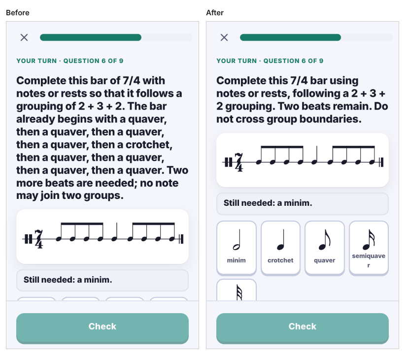 | Same, 320 px phone 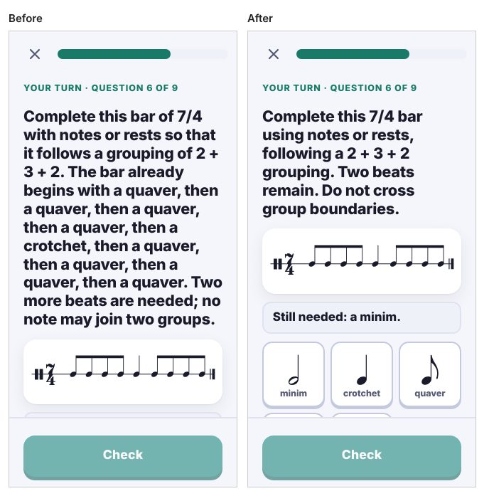 |
| Same, 200% text 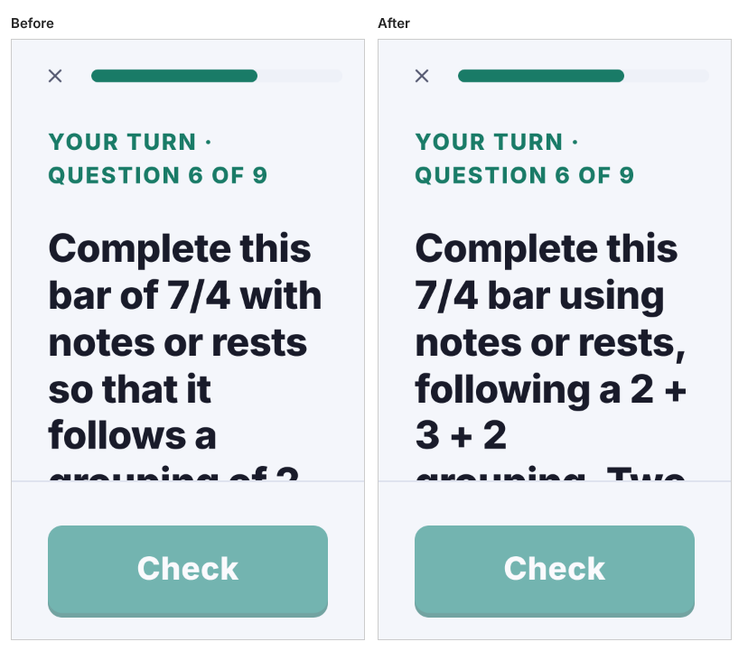 | Approach chord, iPhone 14 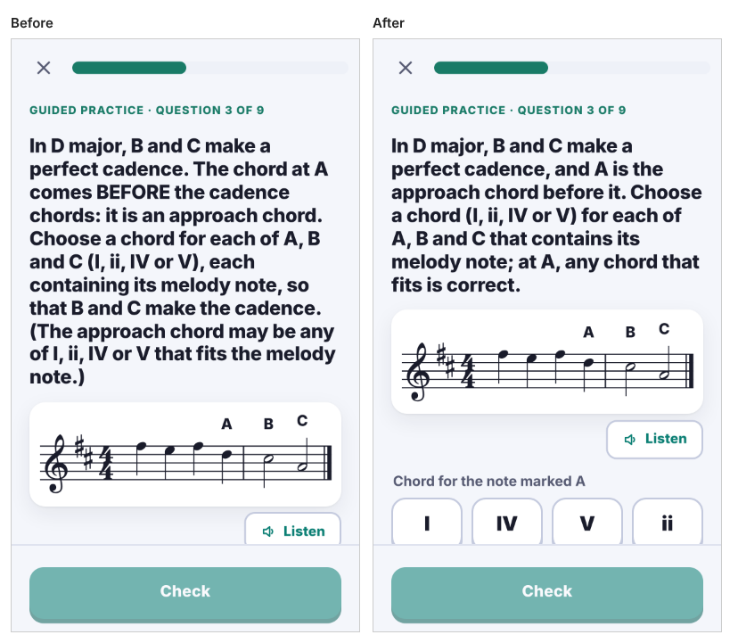 |
| Transposing instrument 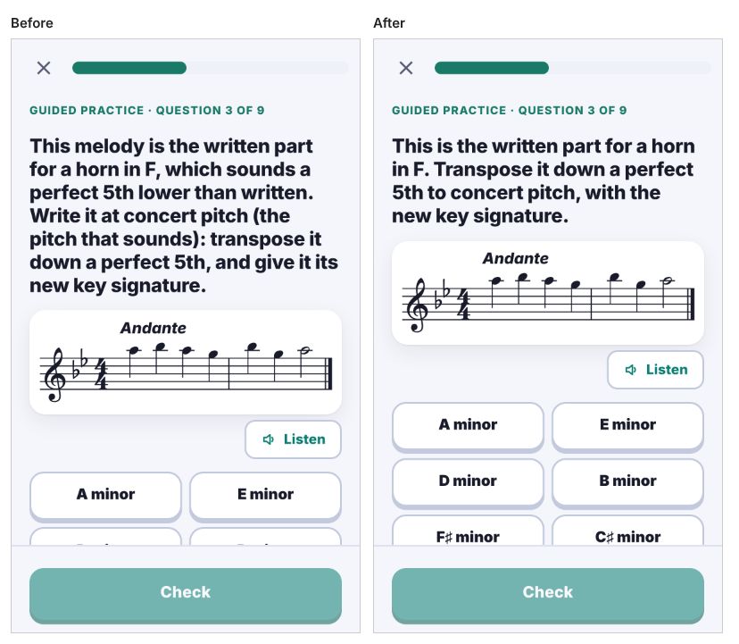 | Nonuplet 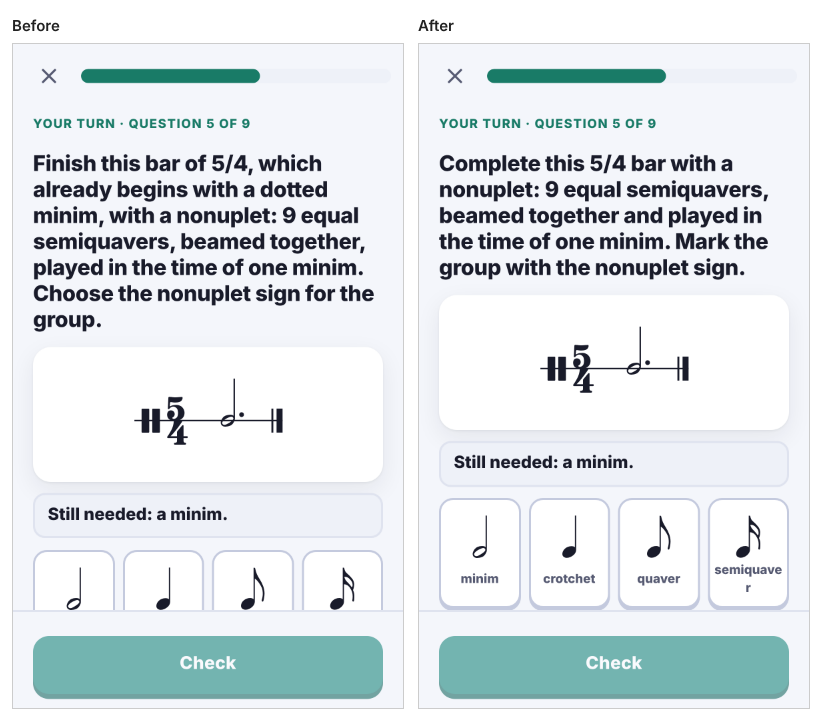 |
| Ornament written out 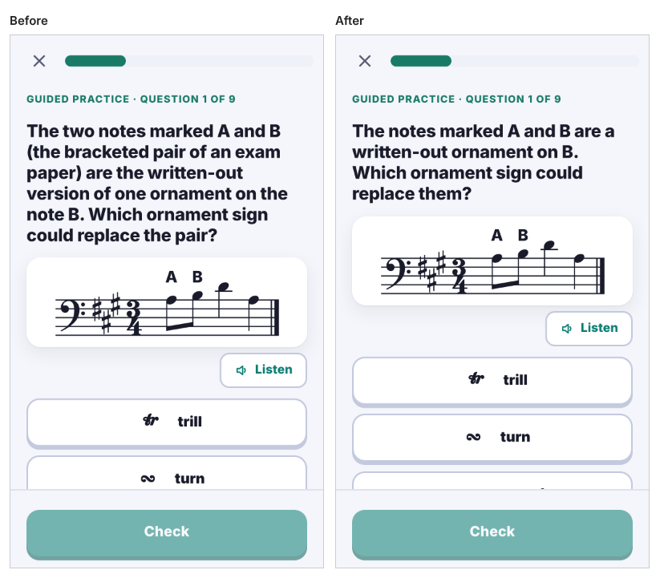 | Interval in a key signature 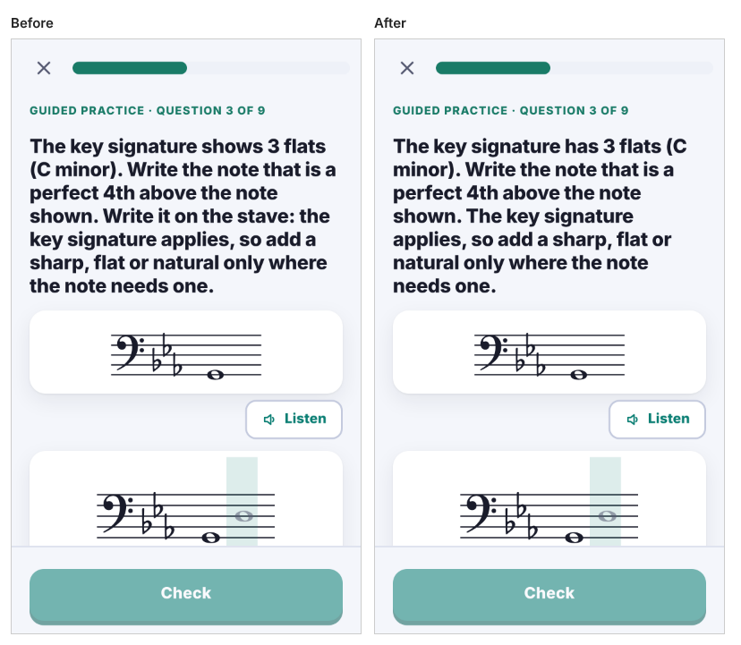 |
| Grade 4 double dot 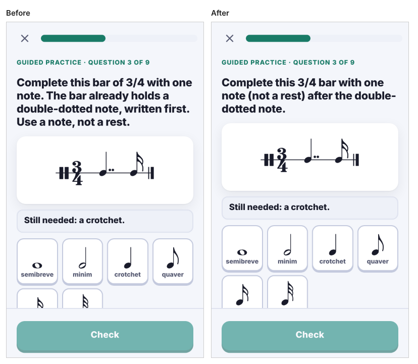 | Grade 1 bar completion 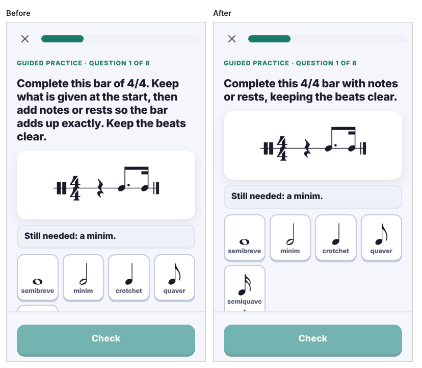 |
| Grade 1 scale 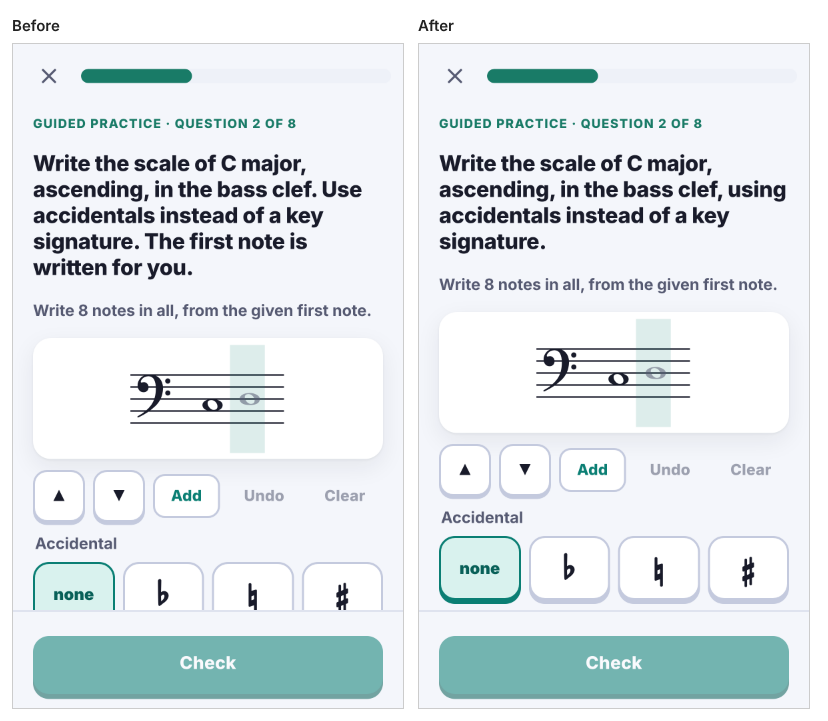 | Approach chord, 320 px 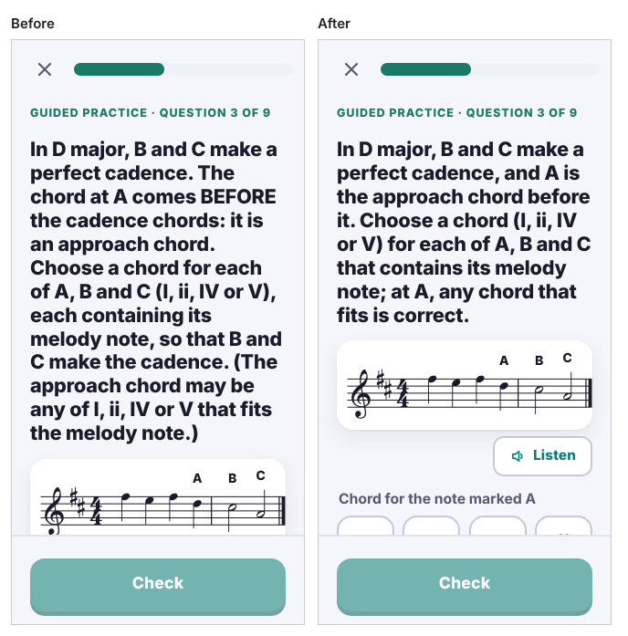 |

No font size, spacing or layout was changed to achieve this: every gain comes from wording.

## 8. Every reworded prompt (one example per template)

42 templates changed, in 1,269 of the 7,884 sampled questions and 201 authored lesson questions. Composite sub-questions, hints and feedback were reviewed and left as they were.

| Template | Before | After | Words |
|---|---|---|---|
| `g1.accidental-write` | Write F♯ in the treble clef. Put the sharp sign in front of the note. Any F♯ that fits is correct. | Write F♯ in the treble clef, with the sharp sign in front of the note. Any octave is correct. | 21 → 19 |
| `g1.bar-complete` | Complete this bar of 3/4. Keep what is given at the start, then add notes or rests so the bar adds up exactly. Keep the beats clear. | Complete this 3/4 bar with notes or rests, keeping the beats clear. | 27 → 12 |
| `g1.interval-number` | Write a note above F to make a octave in F major. | Write a note above F to make an octave in F major. | 12 → 12 |
| `g1.keyboard` | Find C on the keyboard. Any C is correct. | Find C on the keyboard. Any octave is correct. | 9 → 9 |
| `g1.note-write` | Write A in the treble clef. Keep it on the stave (no ledger lines). Any A that fits is correct. | Write A in the treble clef, on the stave (no ledger lines). Any octave is correct. | 20 → 16 |
| `g1.scale-build` | Write the scale of C major, descending, in the bass clef. Use accidentals instead of a key signature. The first note is written for you. | Write the scale of C major, descending, in the bass clef, using accidentals instead of a key signature. | 25 → 18 |
| `g1.scale-gap` | This is the scale of C major, going up. One note is missing and is shown as a rest. Which note belongs in the gap? | This is the scale of C major, going up, with one note replaced by a rest. Which note is missing? | 25 → 20 |
| `g2.bar-complete` | Complete this bar of 4/2. Keep what is given at the start, then add notes or rests so the bar adds up exactly. Keep the beats clear. | Complete this 4/2 bar with notes or rests, keeping the beats clear. | 27 → 12 |
| `g2.interval-number` | Write a note above F to make a octave in F major. | Write a note above F to make an octave in F major. | 12 → 12 |
| `g2.melodic-preview` | Write the A harmonic minor scale, ascending, in the treble clef. Use accidentals instead of a key signature. The first note is written for you. | Write the A harmonic minor scale, ascending, in the treble clef, using accidentals instead of a key signature. | 25 → 18 |
| `g2.scale-build-major` | Write the scale of D major, ascending, in the treble clef. Use accidentals instead of a key signature. The first note is written for you. | Write the scale of D major, ascending, in the treble clef, using accidentals instead of a key signature. | 25 → 18 |
| `g2.scale-build-minor` | Write the A harmonic minor scale, descending, in the treble clef. Use accidentals instead of a key signature. The first note is written for you. | Write the A harmonic minor scale, descending, in the treble clef, using accidentals instead of a key signature. | 25 → 18 |
| `g2.scale-gap` | This is the scale of C major, going up. One note is missing and is shown as a rest. Which note belongs in the gap? | This is the scale of C major, going up, with one note replaced by a rest. Which note is missing? | 25 → 20 |
| `g3.bar-complete` | Complete this bar of 9/8. Keep what is given at the start, then add notes or rests so the bar adds up exactly. Keep the beats clear. | Complete this 9/8 bar with notes or rests, keeping the beats clear. | 27 → 12 |
| `g3.ledger-count` | Name this note. (It is written in the bass clef.) | Name this note in the bass clef. | 10 → 7 |
| `g3.scale-build-major` | Write the scale of E major, descending, in the treble clef. Use accidentals instead of a key signature. The first note is written for you. | Write the scale of E major, descending, in the treble clef, using accidentals instead of a key signature. | 25 → 18 |
| `g3.scale-build-minor` | Write the E harmonic minor scale, ascending then descending, in the treble clef. Use accidentals instead of a key signature. The first note is written for you. | Write the E harmonic minor scale, ascending then descending, in the treble clef, using accidentals instead of a key signature. | 27 → 20 |
| `g3.scale-gap` | This is the E harmonic minor scale, going up. One note is missing and is shown as a rest. Which note belongs in the gap? | This is the E harmonic minor scale, going up, with one note replaced by a rest. Which note is missing? | 25 → 20 |
| `g4.alto-write` | Write F♯ in the alto clef. You may use up to 2 ledger lines. Any F♯ that fits is correct. | Write F♯ in the alto clef, using up to 2 ledger lines. Any octave is correct. | 20 → 16 |
| `g4.chord-root` | This chord is made from the notes of one triad in F♯ minor. Answer both questions: is it in root position, and which note is its root? | This chord is made from the notes of one triad in F♯ minor. Is it in root position, and which note is its root? | 27 → 24 |
| `g4.double-cancel` | A note has been written with a double sharp. Later in the same bar the same note must be plain again, with no sharp or flat at all. Which sign is written before it? | A note has a double sharp. Later in the same bar, that note must be plain, with no sharp or flat. Which sign is written before it? | 34 → 27 |
| `g4.double-dot-bar` | Complete this bar of 4/4 with one note. The bar already holds a double-dotted note, written first. Use a note, not a rest. | Complete this 4/4 bar with one note (not a rest) after the double-dotted note. | 23 → 14 |
| `g4.double-write` | Write F𝄪 in the bass clef. You may use up to 2 ledger lines. Any F𝄪 that fits is correct. | Write F𝄪 in the bass clef, using up to 2 ledger lines. Any octave is correct. | 20 → 16 |
| `g4.octave-transpose-alto` | Write this melody an octave lower in the treble clef, keeping the key signature. (The original melody is in the alto clef.) | Write this alto-clef melody an octave lower in the treble clef, keeping the key signature. | 22 → 15 |
| `g4.same-pitch` | This note is written in the treble clef. Write the note that sounds exactly the same, in the alto clef. (Same pitch, not an octave higher or lower.) | Write this treble-clef note at the same pitch in the alto clef (not an octave higher or lower). | 28 → 18 |
| `g4.scale-build` | Write the scale of B major, ascending then descending, in the treble clef. Use accidentals instead of a key signature. The first note is written for you. | Write the scale of B major, ascending then descending, in the treble clef, using accidentals instead of a key signature. | 27 → 20 |
| `g4.term-use` | A conductor points to a passage in your part, which carries the direction “sonoro”. What should the player do? | A passage in an orchestral part is marked “sonoro”. What should the player do? | 19 → 14 |
| `g5.approach-chord` | In F major, B and C make a perfect cadence. The chord at A comes BEFORE the cadence chords: it is an approach chord. Choose a chord for each of A, B and C (I, ii, IV or V), each containing its melody note, so that B and C make the cadence. (The approach chord may be any of I, ii, IV or V that fits the melody note.) | In F major, B and C make a perfect cadence, and A is the approach chord before it. Choose a chord (I, ii, IV or V) for each of A, B and C that contains its melody note; at A, any chord that fits is correct. | 69 → 46 |
| `g5.bar-complete` | Complete this bar of 5/4 with notes or rests so that it follows a grouping of 2 + 3. The bar already begins with a quaver, then a quaver, then a quaver, then a quaver. Three more beats are needed; no note may join two groups. | Complete this 5/4 bar using notes or rests, following a 2 + 3 grouping. Three beats remain. Do not cross group boundaries. | 46 → 22 |
| `g5.cadence-chords` | The melody notes marked A and B come at a cadence point in F major. Choose a chord for each (I, ii, IV or V) so that A and B make an imperfect cadence. Each chord must contain its melody note; any pair that works is correct. | In F major, choose a chord (I, ii, IV or V) for each of the melody notes A and B so that they make an imperfect cadence. Each chord must contain its melody note; any pair that works is correct. | 47 → 40 |
| `g5.chord-build` | Write chord IVa of G minor in the bass clef, in root position (the root of the chord is the lowest note), using exactly 4 notes (one note of the chord is written twice). Any spacing is correct. | Write chord IVa of G minor in the bass clef, in root position (the root as the lowest note), using exactly 4 notes, one of them doubled. Any spacing is correct. | 38 → 31 |
| `g5.chord-choice` | The melody notes marked A and B come at a cadence point in D major. Which pair of chords, with each chord containing its melody note, makes an imperfect cadence? | In D major, which pair of chords makes an imperfect cadence at the melody notes A and B? Each chord must contain its melody note. | 30 → 25 |
| `g5.clef-minor` | The same eight notes are written on three staves. Each stave has a different clef and no key signature. The accidentals are the same on every stave. Only one of the clefs makes the notes an ascending minor scale (harmonic or melodic form). Which stave is it? | The same eight notes, with the same accidentals, are written on three staves, each with a different clef and no key signature. On which stave do they make an ascending minor scale (harmonic or melodic)? | 47 → 35 |
| `g5.division-write` | Finish this bar of 7/4, which already begins with a minim, then a minim, then a crotchet, with a nonuplet: 9 equal semiquavers, beamed together, played in the time of one minim. Choose the nonuplet sign for the group. | Complete this 7/4 bar with a nonuplet: 9 equal semiquavers, beamed together and played in the time of one minim. Mark the group with the nonuplet sign. | 39 → 27 |
| `g5.instrument-transpose` | This melody is the written part for a cor anglais (in F), which sounds a perfect 5th lower than written. Write it at concert pitch (the pitch that sounds): transpose it down a perfect 5th, and give it its new key signature. | This is the written part for a cor anglais (in F). Transpose it down a perfect 5th to concert pitch, with the new key signature. | 42 → 25 |
| `g5.interval-key-build` | The key signature shows 4 sharps (C♯ minor). Write the note that is a major 6th above the note shown. Write it on the stave: the key signature applies, so add a sharp, flat or natural only where the note needs one. | The key signature has 4 sharps (C♯ minor). Write the note that is a major 6th above the note shown. The key signature applies, so add a sharp, flat or natural only where the note needs one. | 42 → 37 |
| `g5.interval-key-identify` | The key signature shows 6 sharps (F♯ major). Name the interval between these two notes, from the lower to the higher: give its quality and its number. Remember that the key signature applies to every note on the stave. | The key signature has 6 sharps (F♯ major) and applies to both notes. Name the interval from the lower note to the higher: quality and number. | 39 → 26 |
| `g5.ornament-replace` | The beamed group of short notes at the start of this bar (starting at the note marked A) is the written-out version of one ornament on the note E♭. Which ornament sign could replace the group? | The beamed group starting at the note marked A is a written-out ornament on E♭. Which ornament sign could replace it? | 36 → 21 |
| `g5.rewrite-metre` | This bar is written in 4/4, where the beat is a crotchet. Rewrite it in 12/8, where the beat is a dotted crotchet. Every note and rest keeps its share of its beat, so the music moves at the same beat speed. Beam the notes as 12/8 requires. | Rewrite this 4/4 bar in 12/8, so that each crotchet beat becomes a dotted crotchet beat. Every note and rest keeps its share of the beat. Beam the notes as 12/8 requires. | 48 → 32 |
| `g5.scale-build` | Write the scale of F♯ major, descending, in the bass clef. Use accidentals instead of a key signature. The first note is written for you. | Write the scale of F♯ major, descending, in the bass clef, using accidentals instead of a key signature. | 25 → 18 |
| `g5.tenor-write` | Write A in the tenor clef. You may use up to 2 ledger lines. Any A that fits is correct. | Write A in the tenor clef, using up to 2 ledger lines. Any octave is correct. | 20 → 16 |
| `g5.transpose-judge` | The top stave is concert pitch. A pupil has transposed it up a minor 3rd to give the written part for the clarinet in A (the clarinet in A sounds a minor 3rd lower than written). Look at the lower stave carefully, noting that the notes are numbered. Which statement is true? | A pupil has transposed the top stave up a minor 3rd for the clarinet in A. Which statement about the pupil's version is true? | 52 → 24 |

## 9. Questions for a teacher

1. **Remaining beats in bar completion (Grade 5).** Kept ("Two beats remain") so challenges and assessments, where the meter is silent, ask exactly what practice asks. A teacher may prefer to drop it in practice only, which would need two versions of the template.
2. **Transposing-instrument prompts (Grade 5)** no longer restate "which sounds a minor 3rd lower than written" beside "transpose it down a minor 3rd". The direction and interval are still given, as on a typical exam paper; the reason is in the hint. Is the restated reason wanted as teaching support?
3. **Chromatic-semitone interval facts (Grade 5)** still end "the letter name stays the same, so the number does not change", which tells the learner half of the answer. Kept unchanged because removing it makes the question harder; a teacher should decide whether it belongs in a hint instead.
4. **Chord writing (Grade 5)** keeps a short gloss of the position ("in first inversion (the 3rd as the lowest note)"). Should Grade 5 learners be expected to know the letters a/b/c without it?
5. **Grade 1 melody detail** ("What is the interval, by number, from the nearest tonic at or below the note marked x, up to x?") is precise but awkward; it was left because the precision matters (the note marked x may itself be the tonic). A teacher may know a clearer classroom phrasing.
6. **Term-use situations (Grade 4).** The six situations were rewritten to one short neutral sentence each. Should they go entirely ("This passage is marked …")?

## 10. Unrelated visual defects noticed (not changed)

* The rhythm palette label "semiquaver" breaks mid-word ("semiquave / r") on phones (visible in the reported screenshot and in ours).
* On phones the fifth palette button (demisemiquaver) and the answer stave of interval-writing questions start underneath the fixed **Check** bar, so the learner must scroll to reach them, whatever the prompt length.
* At 200% text the fixed **Check** bar takes almost half of a phone screen.

## 11. Validation

VALIDATION
